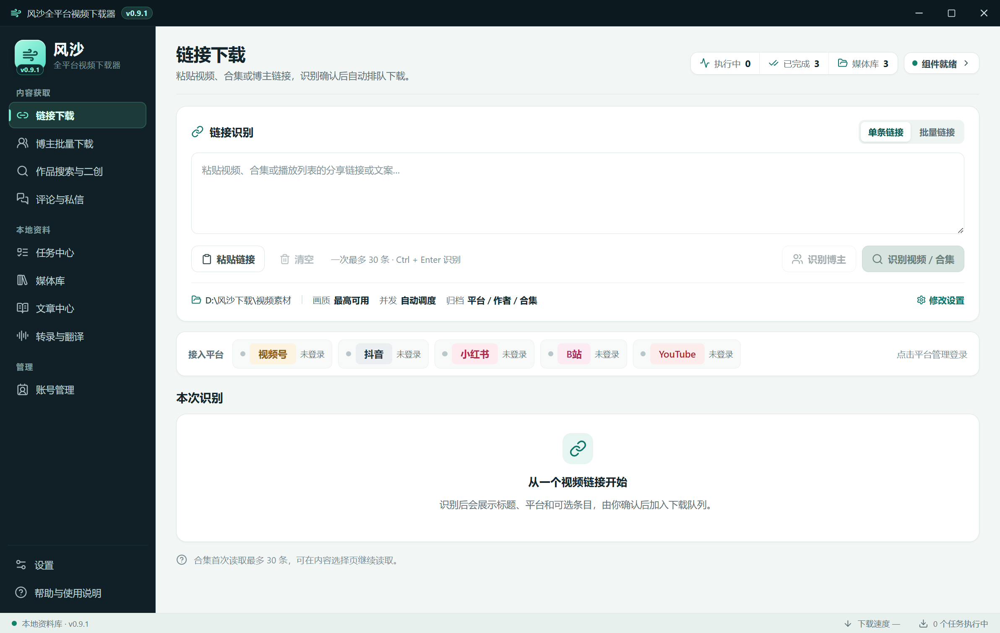
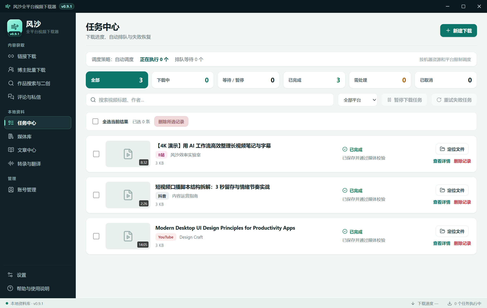
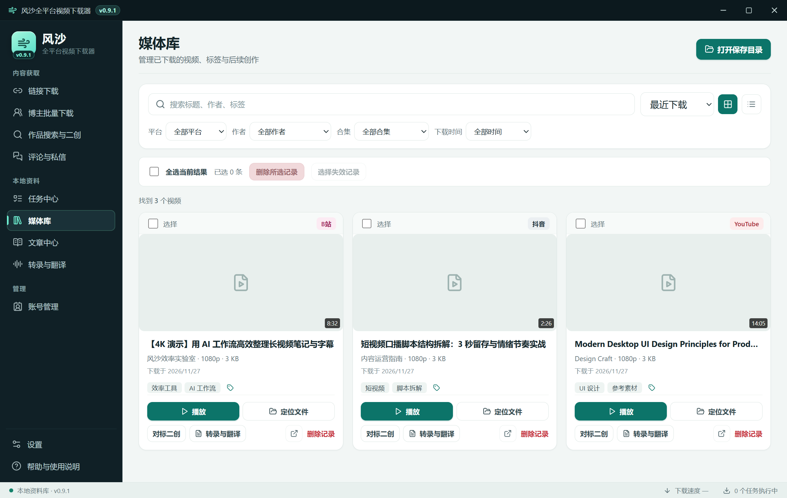
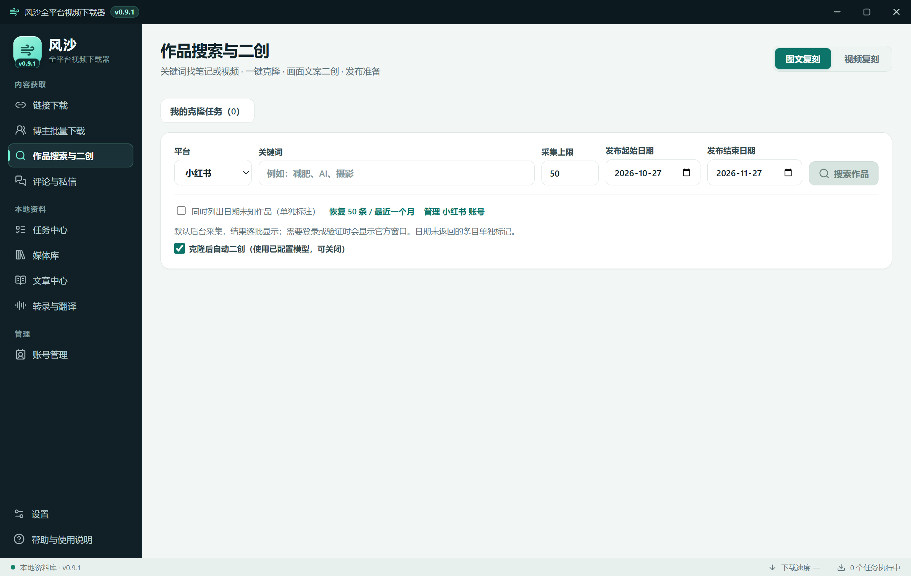
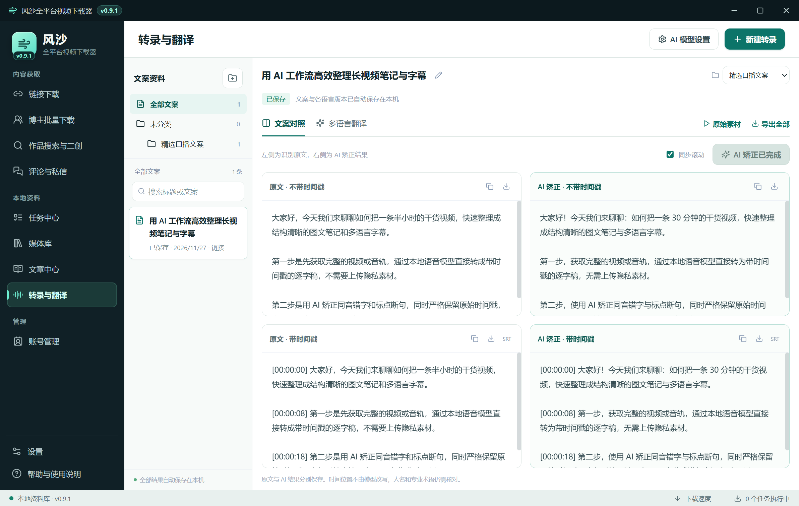
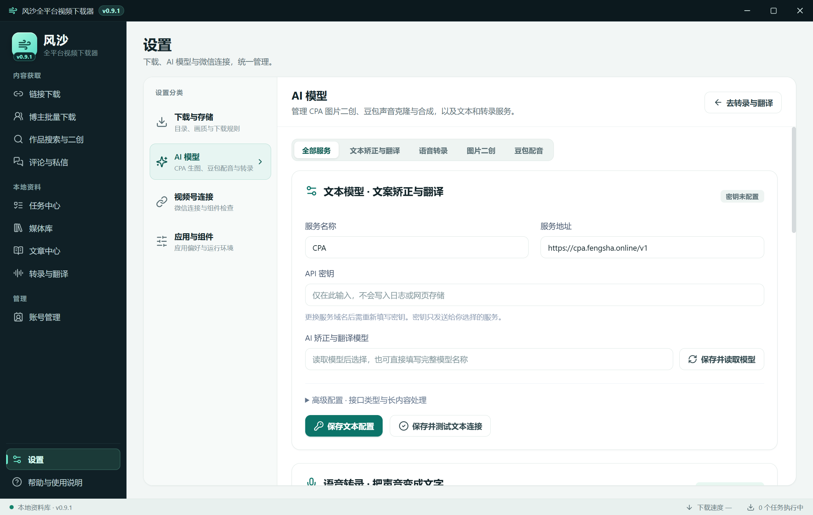
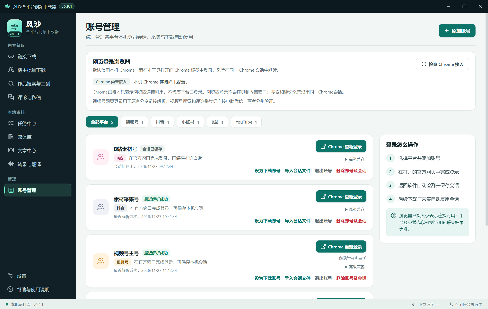

# 风沙全平台视频下载器

> **当前版本：`v0.9.1`** · Windows x64 桌面应用  
> 一站式 **多平台视频/图文获取 · 博主批量下载 · 作品搜索与二创 · 评论采集与私信 · 离线语音转录与翻译** 工作台。



---

## 核心功能

### 1. 链接下载 & 博主批量获取
- **单条 / 批量识别**：直接粘贴视频链接、分享文案或博主主页（单次最多 30 条，支持 `Ctrl + Enter` 快捷识别）。
- **实时平台登录状态**：首页直观展示各平台账号状态，点击一键跳转管理登录。
- **博主作品筛选**：按发布时间、关键词、数量分页读取作品列表，自动跳过已下载内容。

### 2. 任务中心 & 本地媒体库
- **自动并发调度**：按本机性能与平台限流自动排队、合并音视频并校验完整性，支持断点恢复与失败重试。
- **媒体资产管理**：按平台、作者、合集、时间与标签组合检索，支持一键播放、定位本地文件、直接发起转录或对标二创。





### 3. 作品搜索、对标二创 & 评论私信
- **图文复刻 & 视频复刻**：支持关键词搜索多平台作品，一键克隆原稿与素材，对照编辑文案、AI 改图、视频转图文与豆包配音。
- **评论与私信工作台**：批量采集作品评论与公开用户资料，支持关键词筛选、用户去重与私信模板准备。
- **文章中心**：支持公众号文章与小红书图文链接混合采集、离线保存（Markdown / HTML / TXT / JSON）与正文预览。



### 4. 离线语音转录、AI 矫正 & 多语言翻译
- **内置离线语音引擎**：无需配置语音 API 密钥即可本地转写中/英/日/韩音视频，自动生成纯文本与带时间戳版本。
- **四窗格对照工作区**：左侧保留识别原文，右侧展示 AI 矫正结果，支持同步滚动与精确时间戳保留，一键导出 TXT / SRT / Markdown。
- **多语言并行翻译**：支持同时翻译为多种目标语言，独立保存各语言版本并支持断点续传。



### 5. 统一设置 & 多平台账号管理
- **独立会话隔离**：多平台、多账号加密存储本机登录会话，软件自动管理专用浏览器，无需手填端口或 IP。
- **分类设置中心**：集中管理下载存储、AI 模型（文本 / 语音 / 图片 / 配音分组切换）、微信视频号连接与运行组件状态。





---

## 平台支持一览

| 平台 | 单视频 / 链接下载 | 博主批量 / 作品搜索 | 评论采集 | 说明 |
| --- | :---: | :---: | :---: | --- |
| **YouTube** | 支持 | 支持 | 支持 | 公开内容可直接解析；受限内容需账号会话 |
| **B站** | 支持 | 支持 | 支持 | 支持分 P 独立识别；博主列表需先登录 B站账号 |
| **抖音** | 支持 | 支持 | 支持 | 使用应用内独立官方网页会话，按需弹出验证窗口 |
| **小红书** | 支持 | 支持 | 支持 | 支持视频与图文笔记采集、文章中心离线保存 |
| **微信视频号** | 支持 | 支持 | 支持 | 内置微信采集组件，支持 Clash 规则模式共存，任务结束自动恢复网络 |
| **微信公众号** | 文章中心 | 支持 | — | 支持链接批量采集、作者列表读取与离线图文保存 |

> 仅获取当前账号有权访问的内容，不包含付费绕过、直播录制等能力；实际可用性受各平台接口、登录状态与风控策略影响。

---

## 快速开始

### 方式一：直接安装使用（推荐）

1. 运行 `FengshaVideoDownloader-0.9.1-setup.exe` 完成一键安装（内置下载引擎、FFmpeg、微信辅助组件与离线语音模型，**无需安装 Node.js 或 Python**）。
2. 双击桌面 **风沙全平台视频下载器** 快捷方式启动，左上角图标带有当前版本号标识（如 `v0.9.1`）。
3. 公开视频可直接粘贴链接识别下载；需要登录的平台在左侧 **账号管理** 中添加账号并完成官方网页登录即可。

### 方式二：源码运行与打包

```powershell
# 1. 安装依赖
pnpm install

# 2. 启动桌面应用
pnpm start

# 3. 语法检查与前端构建
pnpm run check

# 4. 运行单元测试
pnpm test

# 5. 打包 Windows 安装程序（输出至 release/）
pnpm run dist
```

### 方式三：命令行（CLI / Agent）调用

安装版自带 `fengsha-cli.cmd`，默认输出结构化 JSON，支持自动化脚本或 Agent 调用：

```powershell
node cli/fengsha.mjs inspect "视频分享链接"
node cli/fengsha.mjs download "视频分享链接" --output "D:\风沙下载"
node cli/fengsha.mjs media
```

---

## 详细文档

- [完整使用说明与常见问题](docs/使用说明.md)
- [安装、源码部署与打包指南](docs/安装部署.md)
- [作品二创与评论采集指南](docs/作品二创与评论采集.md)
- [微信视频号与代理共存方案](docs/网络代理共存方案.md)
- [CLI 命令行调用文档](docs/CLI使用说明.md)
- [第三方组件与开源许可](THIRD-PARTY-NOTICES.md)
