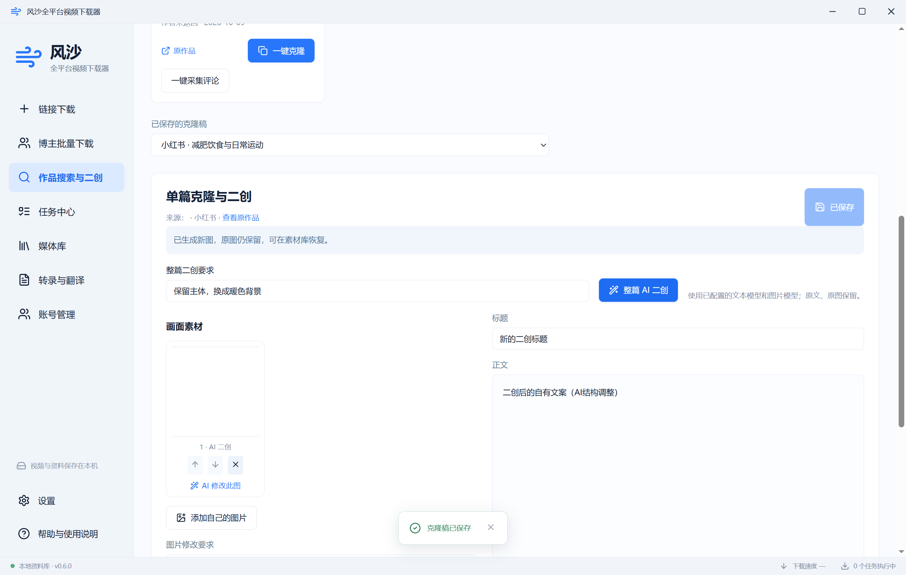

# 风沙全平台视频下载器

Windows 桌面应用，提供 **视频链接识别与下载、博主作品批量下载、本地媒体管理、语音转录、AI 文案矫正和多语言翻译**。

当前版本：**0.6.5**。仓库：[123225073/AI_Video_Download](https://github.com/123225073/AI_Video_Download)。

“全平台”是产品名称，当前接入 YouTube、B站、抖音、小红书、微信视频号；实际可用性受登录状态、访问权限、地区、限流与平台接口变化影响。各平台的实测范围见下表。

## 文档入口

- [安装、源码部署、组件准备与打包](docs/安装部署.md)
- [完整使用说明与失败处理](docs/使用说明.md)
- [CLI 与 Agent 调用说明](docs/CLI使用说明.md)
- [0.4.0 CLI 与图文交付验收](docs/验收-0.4.0.md)
- [第三方组件、来源与许可](THIRD-PARTY-NOTICES.md)
- [0.3.8 统一设置历史验收](docs/验收-0.3.8.md)
- [0.3.7 转录与翻译历史验收](docs/验收-0.3.7.md)

## 0.6.5 独立克隆工作台与真实流式文案

一键克隆立即进入独立工作台，显示动态阶段和已等待时间；正文、原画面逐步保存，AI 文案流式预览、生成画面按张显示。原作品在可见独立窗口打开，沿用平台账号并显示失败原因。返回搜索保留未保存编辑，取消／失败保留原稿；修复迟到读取响应覆盖新图片。详见 [0.6.5 验收](docs/验收-0.6.5.md)。

## 0.6.3 后台搜索与实时结果

已登录时后台采集，无需显示官网；需要登录／验证时自动显示，仍可手工打开。列表读取与真实日期核验同时进行，符合条件的作品逐批显示，停止后保留已取得结果。修复新关键词搜索期间显示旧结果的问题。详见 [0.6.3 验收](docs/验收-0.6.3.md)。

## 0.6.2 小红书真实搜索修复

修复官方 HTTP 规范化跳转引发的 ERR_FAILED、搜索路径末尾斜线、卡片访问令牌丢失、续读覆盖详情，以及 HTTP CDN／WebP 导致的图片丢失。已用应用内实际登录会话读取“减肥”作品，并验证日期筛选和原文图片克隆。上限 50 条不等于保证 50 条匹配作品，可继续读取。详见 [0.6.2 验收](docs/验收-0.6.2.md)。

## 0.6.1 CPA 生图与豆包声音

图片统一连接 CPA，默认使用已真实改图验证的 `gpt-image-2.5-sunburst`，可选择 CPA 的其他 GPT Image 2.5 型号。设置支持保留原声或豆包合成，以及选定音色自动执行或确认正文／音色后执行。支持复刻音色样本提交、状态查询和防重复训练；原声和原素材保留。视频使用关键帧改图与 FFmpeg 拼接，不接入视频生成模型。


操作步骤与实测范围见 [声音与 CPA 二创说明](docs/作品二创与评论采集.md) 和 [0.6.1 验收](docs/验收-0.6.1.md)。

## 0.6.0 作品搜索与二创

新增五平台关键词找作品，默认 50 条、最近一个月；选中单篇克隆正文与图片，支持自动 AI 改写／GPT Image 2.5 改图、关键画面视频生成、编辑导出和官方账号发布。新增所选作品的评论／公开评论者采集、同人去重及逐位私信准备与提交。



真实 YouTube 作品搜索通过；CPA GPT Image 2.5 改图已真实验证；五平台正式发布和私信仍未完成真实账号验收。功能操作、边界及验证矩阵见 [作品二创与评论采集](docs/作品二创与评论采集.md)。

## 0.5.1 视频号代理共存

视频号搜索自动准备连接；Clash Verge 规则模式保留系统代理、内核与守卫，只添加视频号专用分流，并处理结束和异常退出恢复。无需每次关闭代理；Windows 证书确认及微信登录仍由本人完成。详见 [代理共存使用说明](docs/网络代理共存方案.md)。

## 0.5.0 关键词搜索用户

旧版用户搜索保留 CLI 兼容；桌面入口已改为作品搜索。原功能支持视频号、抖音、小红书、B站、YouTube。输入关键词后展示候选用户的公开资料，核对主页和用户 ID，再进入原有博主作品读取；CLI 新增 search 命令。


YouTube 已通过真实公开网络测试；其他平台仍受登录、微信连接和当前网络风险影响。功能方式、图文操作与真实验证范围见 [用户搜索说明](docs/用户搜索.md) 和 [0.5.0验收](docs/验收-0.5.0.md)。

## 0.4.3 B站登录前提醒

B站博主识别、作品读取、继续读取和信息补全会先检查应用内登录会话；未添加账号、未完成登录、会话过期时提示先登录，并可进入 B站账号管理，保存会话后返回原页面。未通过检查不会向平台发送清单请求，也不改已有清单。CLI 返回明确登录错误。

单条公开视频识别/下载及历史清单查看仍沿用原流程。会话保存不保证平台解除限制；本次模拟会话用于验证提示和后续流程，真实登录后的全量列表仍需平台允许。详见 [0.4.3验收](docs/验收-0.4.3.md)，此前请求修复见 [0.4.2报告](docs/验收-0.4.2.md)。

## Agent CLI

0.4.0 新增命令入口：识别链接、分页读取博主、下载、查询任务、读取媒体、检查本地视频。默认输出 JSON，桌面已打开时复用该进程；未打开时自动启动后台，空闲后退出。


```powershell
node cli/fengsha.mjs inspect '视频分享链接'
node cli/fengsha.mjs download '视频分享链接' --output 'D:\视频素材'
node cli/fengsha.mjs media
```

安装版提供 fengsha-cli.cmd，使用包内 Node，无需另装环境。多条清单必须选择 --indices 或明确 --all，下载完成返回文件路径；异步与超时应查询 tasks。完整参数见 [CLI 文档](docs/CLI使用说明.md)。

## 现有功能

### 1. 链接下载与内容选择

- 从单条链接或含链接的分享文案提取地址，识别所属平台、标题、作者、封面与可下载条目；一次最多识别 30 个链接。
- 合集默认最多先读取 30 条，可主动扩大至最多 300 条；页面展示当前清单，不能据此保证源合集全部内容均已读取。
- 勾选需要的作品，选择最高可用、1080p、720p 或 480p 以内的画质，以及保存位置和归档规则。最终画质由源站提供的格式决定。
- 按“平台 / 作者 / 合集”“平台 / 作者”或直接存放到指定目录归档。
- 合集选择超过 30 条会再次确认数量；已存在的完整视频可跳过，也可选择另存一份。
- 下载后合并音视频并检查媒体流。B站分P使用独立内容标识，减少重复和同名冲突。

### 2. 博主批量下载

- 支持从作品链接或主页地址识别采集对象，展示平台、作者昵称和稳定作者 ID；采集对象与自己的登录账号分开展示。
- 范围可选最近 7 / 30 / 90 天、自定义日期或全部可访问作品；数量可选 50 / 100 / 自定义，或持续读取至平台末页。
- 支持标题关键词、排除已下载、是否包含发布时间未知的作品。日期过滤仅作用于已经读取的条目。
- 每页最多读取 50 条，可继续读取、停止并保留清单和游标，重启后继续。
- 展示平台报告数量、实际已读取数量和筛选后数量；平台没有返回总数时显示未知。
- 勾选后直接加入下载队列，每 200 条分批提交。队列没有固定总数上限，仍受磁盘和内存约束。
- 页面到达末页仅代表当前可访问范围，不代表完整覆盖该账号历史作品。

### 3. 任务中心与自动调度

- 查看下载中、等待 / 暂停、已完成、需处理和已取消任务；按标题、作者或平台筛选。
- 支持暂停、继续、取消、失败重试和登录后重试；任务与状态保存到本机，重启后恢复记录。
- 并发支持自动调度或 1—99 上限，实际执行数根据 CPU、空闲内存、合并负载与平台限制调整，其余排队。
- 当前每个平台保护上限：YouTube 4、B站 3、视频号 / 抖音 / 小红书 2。99 不表示必然同时启动 99 个下载。
- 对网络故障和限流执行可配置的自动重试，默认 3 次；登录失效、链接失效或磁盘不足需处理原因后重试。
- 诊断信息隐藏完整 URL、Cookie 与认证字段；关闭窗口且仍有下载任务时提示是否暂停退出。

### 4. 本地媒体库

- 管理已完成视频记录，搜索和按平台筛选，调用默认播放器播放，打开文件所在位置。
- 已下载视频可直接进入“转录与翻译”。
- 文件被移动或缺失时明确标注，支持重新定位；修改默认目录不会自动搬迁旧视频。
- 重复检测同时检查文件是否仍存在，避免仅凭旧记录跳过已经丢失的文件。

### 5. 转录、AI 矫正与多语言翻译

- 素材来源：视频 / 播客链接、媒体库视频、本地音视频、TXT / Markdown 文稿、SRT / VTT 字幕，或粘贴文本。
- 链接优先读取字幕，没有字幕时下载音频转录。支持本地 CPU Whisper 和兼容的在线语音服务；仅本地转录不需要文本 AI 密钥。
- 新安装默认本地 small 模型、简体中文；base 更侧重速度。长音频按 10 分钟切分处理。
- 建立父目录与子目录、重命名、移动素材和全文搜索；文案与结果自动保存。
- 工作区按两行两列展示：上方纯文本原文与矫正结果，下方带时间戳原文与矫正结果；同类文案可同步滚动。
- 点击“AI 矫正”后才调用文本模型，同时生成纯文本和带时间戳版本；时间位置沿用原字幕，不由模型重造。
- 翻译单独选择原文 / 矫正文案、纯文本 / 时间戳格式和目标语言。可选择英语、日语、韩语、法语、德语、西班牙语、简体中文，结果并排展示并分别保存。
- 已完成语言和分段可复用；漏段、乱序或截断结果不会当作完整结果保存。AI 人名、数字和专业术语仍需人工核对。
- 支持复制、TXT、SRT 和包含全部版本的 Markdown 导出。纯文本没有真实时间戳时不伪造时间。
- 当前界面不提供摘要、笔记或归档确认；历史资料保留，可在完整导出中查看。

### 6. 平台账号与视频号连接

- 同一平台可保存多个独立账号，并指定下载使用账号；在本应用的官方登录窗口自行完成扫码或登录。
- 支持主动选择并导入 Netscape 格式 Cookie 文件；不扫描外部浏览器或复制其他软件账号。
- 会话使用 Windows 加密保存，认证失效时引导重新登录；“会话已保存”不代表所有链接均可访问。
- 视频号博主功能通过内置独立组件连接当前微信；微信登录、验证与视频号页面仍由用户在微信完成。
- 自动连接按任务临时信任专用证书并切换当前用户代理，最后一个任务结束、失败或取消后恢复；异常退出有独立恢复守护，重启会检查未完成记录。
- 视频号连接会影响任务期间的当前用户网络设置。原有 PAC 或无法安全处理的复杂代理不会直接覆盖，可选择手动连接模式。
- 保留原有元宝登录会话的单条视频号链接解析。视频号恢复任务重新下载，不保证断点续传。

### 7. 统一设置

0.3.8 将配置集中到一个“设置”入口，包含：

| 分类 | 配置内容 |
| --- | --- |
| 下载与存储 | 目录、画质、并发、重试、归档、重复跳过、账号管理入口 |
| AI 模型 | 服务名称、地址、模型、密钥、文本协议、语音模式、模型目录读取和连接测试 |
| 视频号连接 | 组件准备、状态检查、恢复原网络、自动 / 手动连接 |
| 应用与组件 | 开机启动、应用版本、yt-dlp / FFmpeg / ffprobe / Node 环境检查 |

业务页面的快捷设置按钮直达对应分类；分类切换保留未保存输入，各分类独立滚动。开机启动仅安装版生效。

## 平台支持与验证边界

以下实测结论来自项目已有验收记录，本次上传没有使用真实账号再次执行平台全量采集。

| 平台 | 实现方式 | 已有验证及限制 |
| --- | --- | --- |
| YouTube | yt-dlp，作品解析与频道上传列表 | 公开作品作者识别与公开频道列表已有实测；未声明遍历账号全部作品，登录验证、地区限制和限流可能中断 |
| B站 | yt-dlp 视频下载、原生签名列表与详情 | 作者识别、历史8条信息和封面已有实测；博主读取会先要求应用内保存登录会话，全量读取待实测 |
| 抖音 | 本应用独立官方网页会话和作品接口 | 已实测原作者识别、主页可见作品读取与真实 MP4 下载；不保证全部历史作品，图文和受限内容不作为视频下载 |
| 小红书 | 官方主页可见视频笔记列表，实验接入 | 实际账号全量采集及下载尚未验收，不将其列为稳定完成能力 |
| 微信视频号 | wx_channels_download v260907 与独立 worker；兼容元宝单视频路径 | 作者列表、勾选、加密视频下载与解密播放已有隔离接口测试；真实当前微信作者列表与下载仍需现场验收 |

本地语音转录已有合成中文音频实测；0.3.7 安装版已有真实 CPA 模型的成对矫正、英语 / 日语纯文本与时间戳翻译验证。其他目标语言未逐一验收翻译质量。模拟服务测试不能代替平台或真实模型验收。

直播录制、付费 / 私密内容绕过、任意格式转换、图书图文视频生成和自动发布不属于当前已交付功能。独立图书带货研究材料未纳入本源码仓库。

## 安装与源码运行

这是 Windows x64 桌面项目，当前没有服务器、Docker 或纯浏览器部署方案。`pnpm dev` 只启动前端调试服务，浏览器中没有 Electron 后端能力。

### 使用现成安装包

取得可信的 `FengshaVideoDownloader-0.4.3-setup.exe` 后运行安装程序，通过桌面或开始菜单打开应用。完整安装包包含下载工具、微信组件与本地语音运行时 / 模型，普通使用无需安装 Node.js 和 Python。

完整安装包见 [v0.4.3 Release](https://github.com/123225073/AI_Video_Download/releases/tag/v0.4.3)；私有仓库需登录具有访问权限的账号。源码仓库仍排除大型运行组件与模型，源码部署按下面步骤准备。

### 从源码运行

1. 安装 Git、Windows x64 Node.js 22.12+（建议 22 系列）、pnpm 10。
2. 克隆仓库，在项目目录安装依赖。
3. 按[安装部署文档](docs/安装部署.md)准备 `bin` 中的下载工具、固定版本视频号组件；需要本地转录时另行准备 Python 3.12 运行时与模型。
4. 构建并启动桌面应用。

```powershell
git clone https://github.com/123225073/AI_Video_Download.git
cd AI_Video_Download
npm install --global pnpm@10.13.1
pnpm install --frozen-lockfile
# 首次必须先按安装部署文档准备 bin 组件。
pnpm build
pnpm start
```

私有仓库克隆需要具有访问权限的 GitHub 账号，不要把 Token 写在命令、源码或文档中。项目保留已审查的 `.npmrc`，仅包含 `node-linker=hoisted`。

### 检查与打包

```powershell
pnpm check
pnpm test
pnpm test:e2e
pnpm test:settings
# 已准备完整组件、语音运行时及模型后：
pnpm dist
```

`pnpm dist` 只本地构建，输出 `release/FengshaVideoDownloader-0.4.3-setup.exe`，不会自动发布到 GitHub。`build` 会编译 Windows 视频号辅助 DLL，需要系统 .NET Framework C# 编译器，详见部署文档。

## 典型使用顺序

1. 在“设置 → 下载与存储”确认目录和画质，保持自动并发。
2. “链接下载”粘贴分享链接 → 识别 → 勾选作品 → 加入队列 → “任务中心”查看进度 → “媒体库”播放。
3. 批量作者内容进入“博主批量下载”：识别博主 → 核对作者 → 设置范围 → 读取作品 → 勾选 → 加入队列。
4. 需要登录时，在“账号管理”完成对应平台官方登录后重试。
5. 需要文案时，从媒体库进入“转录与翻译”或新建素材 → 转录 → 按需 AI 矫正 → 选择格式和语言翻译 → 导出。
6. AI 矫正与翻译前，在“设置 → AI 模型”填写自己有权使用的服务地址和密钥、选择模型并测试。

详细按钮说明、视频号连接步骤、数据备份和错误处理见[使用说明](docs/使用说明.md)。

## 数据、配置与隐私

- 源码运行：默认资料在 `.local/用户数据`，下载在 `.local/下载视频`。
- 安装版：以程序所在目录的上一级为基准，分别保存到 `用户数据` 和 `下载视频`；不是固定要求放在某台电脑的 D 盘。
- SQLite 保存任务、设置、媒体和文案；平台会话与 AI 密钥分别加密存放于用户资料目录。原素材不因转录自动删除。
- 使用本地模型识别本地文件时语音不发往在线 ASR；链接解析 / 下载仍访问平台。在线语音会上传音频，AI 矫正与翻译会发送文案到配置的服务。
- 更换下载目录不会移动已有文件。备份前退出应用，再复制完整资料目录和下载文件；加密会话 / 密钥跨机器或跨 Windows 用户可能无法解密，需重新登录和配置。
- Git 排除 `.local`、用户数据库、密钥、会话、原始媒体、模型、二进制、依赖、构建产物和测试输出；保留源代码、锁文件、图标、设计说明、验收文档、第三方许可证和 worker。

## 技术与目录

Electron 40、React 19、Vite 7、SQL.js、Zod、OpenCC-JS；下载依赖 yt-dlp / FFmpeg，视频号通过独立进程适配，本地语音采用 Faster-Whisper CPU 推理。

```text
src/          桌面界面与样式
electron/     主进程、平台适配、队列、账户、AI、转录及持久化
cli/          Agent 命令入口、参数说明与本机通信
bin/          自行准备的外部运行组件；仓库只保留脚本及许可
scripts/      构建、启动、语音环境准备和隔离测试
tests/        核心逻辑自动测试
docs/         使用、部署、设计与历史验收
assets/       应用图标
```

项目当前声明 `UNLICENSED`，私有上传不等于采用开放源码许可。第三方许可证独立适用，视频号上游含 Commons Clause；销售或商业分发前需要核对各组件授权。详见[第三方通知](THIRD-PARTY-NOTICES.md)。
