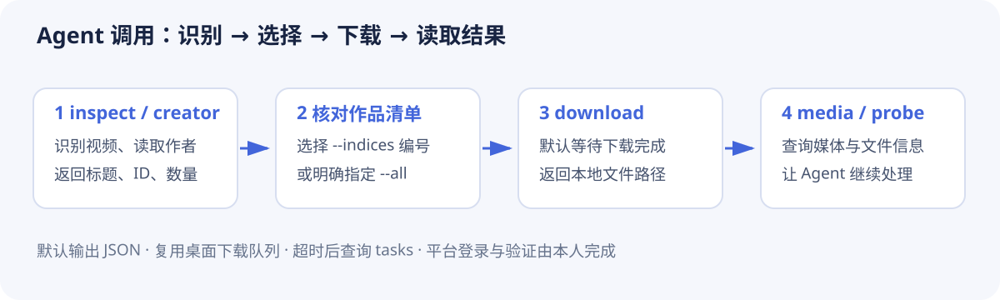

# CLI 与 Agent 使用说明（0.4.3）

Agent 可以直接调用命令识别视频、读取作者作品、下载视频，并取得本地文件路径与媒体信息。所有命令默认输出一个 JSON 对象，退出码标识成功、参数错误、超时或部分失败。



## 1. 选择命令入口

### 已安装的 Windows 版本

0.4.0 安装目录内新增 `fengsha-cli.cmd`，它调用安装包自带的 Node 和程序。普通使用不需要另装 Node / Python。在 PowerShell 中可这样调用，路径替换为自己的实际安装目录：

```powershell
& 'D:\你的安装目录\程序\fengsha-cli.cmd' help
& 'D:\你的安装目录\程序\fengsha-cli.cmd' version
```

Agent 的进程工具可直接启动安装包自带的 Node，避免依赖 Windows shell：

```text
可执行文件：<程序目录>/resources/bin/node/node.exe
参数：<程序目录>/resources/cli/fengsha.mjs inspect <视频链接>
```

`fengsha-cli.cmd` 是批处理入口，使用 `execFile` 的 Agent 应调用 Node 入口，或通过 `cmd.exe /d /c` 调用批处理。无需设置 PATH，不要把账号 Cookie 或 AI 密钥写入命令。

### 源码项目

完成[安装部署](安装部署.md)中的依赖与 bin 组件准备后，调用：

```powershell
node cli/fengsha.mjs help
node cli/fengsha.mjs version
```

`pnpm cli` 适合人工执行；它会额外打印 pnpm 日志。Agent 要解析纯 JSON 时，请直接用 Node 入口。

## 2. 识别链接与读取清单

```powershell
node cli/fengsha.mjs inspect 'https://www.bilibili.com/video/实际BV号' --limit 30
node cli/fengsha.mjs inspect 'https://www.youtube.com/watch?v=实际视频ID' > 视频清单.json
```

也可把包含分享链接的整段分享文案作为一个带引号参数。一次最多识别 30 个链接；合集读取最多 300 条，默认 30。返回内容包括 `groups`、`items`、标题、作者、平台、稳定内容 ID、时长、画质、已读取数量和完整性标记，不返回账号会话和签名媒体下载地址。

```json
{
  "ok": true,
  "command": "inspect",
  "data": {
    "items": [
      {"platform": "B站", "title": "视频标题", "author": "作者", "sourceId": "BV...", "url": "https://www.bilibili.com/video/BV..."}
    ],
    "errors": []
  }
}
```

这是结构示例，不是某个实际平台验收结果。全部链接失败会返回非零退出码；部分失败时 `ok:false`，成功条目仍在 `data.items`，失败原因在 `data.errors`。保存 JSON 请使用 UTF-8；Windows PowerShell 5 的默认重定向可能是 UTF-16，应改用 `Set-Content -Encoding utf8` 或由 Agent 直接保存 stdout。

## 3. 读取博主作品

```powershell
node cli/fengsha.mjs creator 'https://www.youtube.com/@实际频道' --limit 100
node cli/fengsha.mjs creator 'https://www.douyin.com/user/实际作者ID' --limit 50 --period 30 --keyword '读书'
node cli/fengsha.mjs creator 'https://space.bilibili.com/实际UID' --limit 50 --period custom --from 2026-09-01 --to 2026-09-30
```

默认读取最多 50 条，按现有分页适配器读取，最多可指定 100000。`--period` 支持 7、30、90、all、custom；`--include-unknown` 包含日期未知作品，`--include-downloaded` 包含已下载条目。日期、关键词过滤作用于实际读取条目，不表示该作者只有这些符合条件的作品。

返回 `data.id` 是已保存博主清单记录，包含作者身份、`total`、`scanned`、`status`、`complete` 和 `items`。平台未返回总数时为 null；到末页只代表当前可访问范围。中断仍保留清单，返回部分结果和非零退出码。

```powershell
# 查看已保存清单，不再次访问平台：
node cli/fengsha.mjs creator --record '上一步data.id'
# 按清单已保存条件继续读取，原有限额增加50条：
node cli/fengsha.mjs creator --record '上一步data.id' --continue
```

需要改变筛选条件时，用原链接创建一次新的读取。`--continue` 沿用已有条件，命令中新的日期 / 关键词不替换旧条件。

## 4. 直接下载与等待完成

```powershell
node cli/fengsha.mjs download 'https://www.bilibili.com/video/实际BV号' --output 'D:\视频素材' --quality 1080
node cli/fengsha.mjs download --list '视频清单.json' --indices 1,3 --output 'D:\视频素材'
node cli/fengsha.mjs download --record '博主清单ID' --all --archive author
```

默认等待任务完成，返回 `data.files[].filePath`、文件字节数、时长和任务 ID，供 Agent 继续分析或调用其他本地工具。画质支持 best / 1080 / 720 / 480；归档规则支持 flat / author / collection。未指定目录、画质时使用现有桌面设置。

清单只有一条时可直接下载；有多条时必须用从 1 开始的 `--indices` 编号，或明确指定 `--all`，避免 Agent 将整个合集误当成单视频。一次 CLI 提交最多 1000 条，更多需分批。既有文件存在时跳过，并在 `data.existing` 返回路径；`--force` 表示另存一份。

同一来源只选择一种：位置参数链接、`--list` 文件或 `--record` 记录。JSON 清单可直接保存 inspect / creator 输出，也可提供 items 数组。平台和 URL 必须一致。

```json
{
  "ok": true,
  "command": "download",
  "data": {
    "added": ["任务ID"],
    "skipped": [],
    "files": [{"taskId": "任务ID", "filePath": "D:\\视频素材\\作品.mp4", "size": 1234567, "duration": 60}]
  }
}
```

### 异步下载与任务恢复

```powershell
node cli/fengsha.mjs download --list '视频清单.json' --all --no-wait
node cli/fengsha.mjs tasks
node cli/fengsha.mjs tasks --id '任务ID'
node cli/fengsha.mjs task --id '任务ID' --action pause
node cli/fengsha.mjs task --id '任务ID' --action resume
node cli/fengsha.mjs task --id '任务ID' --action retry
node cli/fengsha.mjs task --id '任务ID' --action cancel
```

`--no-wait` 入队后立即返回 ID，任务在同一队列后台执行。`--timeout` 是等待秒数，默认 3600，最多 86400。等待超时不取消已经提交的下载：先查询 tasks，避免重复创建任务。CLI 被强行终止也不等于后台任务已取消；需要取消时调用 task cancel。暂停 / 重试、限流冷却、账号过期与媒体检查沿用桌面逻辑。

## 5. 读取已下载视频

```powershell
node cli/fengsha.mjs media
node cli/fengsha.mjs media --id '媒体ID'
node cli/fengsha.mjs probe --file 'D:\视频素材\作品.mp4'
```

media 返回媒体记录、本地绝对路径、大小、时长、画质及 `exists`。probe 使用现有 ffprobe 检查本地文件的媒体流并返回大小、时长和高度；它不将整个视频编码进 JSON，不替代理解视频画面或语音的模型。Agent 取得 `filePath` 后可将视频交给自己支持的读取、转录或分析工具。

## 6. 运行方式与账号

```powershell
node cli/fengsha.mjs environment
node cli/fengsha.mjs accounts
node cli/fengsha.mjs service
node cli/fengsha.mjs service stop
```

- 桌面已打开：CLI 通过本机命名管道调用该实例，复用同一账号、任务、媒体和配置，不另开第二个资料库写入进程。
- 桌面未打开：自动启动隐藏的后台实例；任务在运行时保留，空闲且没有请求约 30 秒后退出。service stop 只停止空闲后台实例，已有任务或正常桌面窗口时明确拒绝。
- 冷启动需要等待 Electron 与组件检查完成。后台启动失败或旧桌面版本没有 CLI 时先更新版本。
- 默认资料目录与桌面版本一致。`--data-dir 'D:\Agent隔离资料'` 可建立独立资料目录，适合测试；这个目录没有原账号和设置。指定目录只是隔离资料，下载路径仍需用 `--output` 明确选择。
- 本机通道需要该用户资料中的随机认证标记，CLI 自动处理；没有网络 HTTP 监听，不暴露远程 API。标记是本机临时资料，不上传 GitHub。
- CLI 不接收登录密码、Cookie 或 AI 密钥。需要登录 / 扫码 / 验证时由本人在桌面“账号管理”或官方平台窗口完成；可能出现官方网页窗口，无法承诺所有平台无人值守。
- 视频号沿用按任务连接，会临时操作当前用户专用证书与代理，任务结束恢复。真实微信必须在线；组件准备好不等于微信已连接。

## 7. Agent 最小接入约定

1. 先执行 help / version / environment，确认入口、版本与组件。
2. 执行 inspect 或 creator，核对平台、作者、标题、数量和 complete；不把部分清单当成账号全部历史。
3. 从用户授权范围选择编号或明确全部，调用 download。
4. 同时检查进程退出码和 JSON 的 ok。成功后使用 files / existing 的 filePath；异步或超时先查询 tasks。
5. 遇到登录、限流、私密内容或平台验证码时报告明确原因，交由本人处理；不循环盲目重试。
6. accounts 只用于查看状态，不读取本机加密会话或向其他应用传递凭据。

| 退出码 | 含义 | Agent 建议动作 |
| --- | --- | --- |
| 0 | 命令成功，下载模式可能是完成、去重或明确的异步入队 | 查看 data 中对应字段 |
| 1 | 运行失败，例如平台登录 / 组件 / 网络错误 | 读取 error.code / message，处理原因 |
| 2 | 参数、清单、编号或批量选择错误 | 修正调用参数 |
| 3 | 等待超时 | 查询 tasks，后台可能仍在执行 |
| 4 | 部分读取 / 部分下载未完成 | 保留成功结果，核对未完成部分 |

CLI 没有扩大平台支持范围。小红书仍为实验接入，真实微信作者采集仍需现场验证；既有公开平台实测范围见 [README](https://github.com/123225073/AI_Video_Download)。源码 CLI 与安装版验收记录见 [0.4.0 验收](https://github.com/123225073/AI_Video_Download/blob/main/docs/验收-0.4.0.md)。

## 0.4.2：补全 B站旧清单

```powershell
node cli/fengsha.mjs creator --record '博主清单ID' --refresh
```

每次最多补50条缺失信息。它保留原来的读取位置与已取得字段，不重新下载视频；返回 metadataMessage / metadataPending。仍有缺失时返回退出码4，修复成功返回0。不能与 --continue 同时使用。原生列表单页30条，--limit仍为原来的数量上限。inspect返回metadataOnly:true时只确认视频信息，实际格式需在下载时解析。平台请求受限仍需本人更新会话、验证或等待。

## 0.4.2：中断与超时

`creator` 在读取失败时保留已取得的 `items`，返回 `complete:false`、`partial:true` 和退出码4。`restartRequired:true` 表示下次继续会从第一页重新读取，例如切换账号或失败的重读；Agent 应说明这一点。普通中断仍沿用有效读取位置，不重复提交下载。

`download --timeout` 的等待预算从发出下载请求开始，包含解析、入队和完成轮询，不在入队后重新计时；服务冷启动另有启动等待。轮询超时返回已入队 ID，任务继续后台执行。复用排队期间恢复的完整文件也返回文件路径、大小与时长。平台账号会话只通过桌面账号管理配置，CLI 不读取普通浏览器的私密登录资料。

## 0.4.3：B站登录前置提示

B站 `creator 链接`、`creator --record ID --continue` 和 `creator --record ID --refresh` 在应用未保存可用登录会话时返回 `ok:false`、`error.code:BILIBILI_LOGIN_REQUIRED` 和退出码1。Agent应提示本人进入桌面账号管理完成 B站登录；不要循环重试，也不要把它解释成平台已经拒绝了本次清单请求。

`creator --record ID` 仅读取历史结果，不要求重新登录。单条公开视频的 inspect/download不增加这一博主登录前置限制。账号状态与本机登录资料的存在仅作为前置检查，平台实际有效性仍以请求响应为准。
