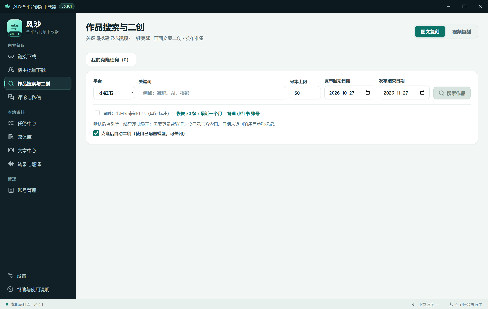
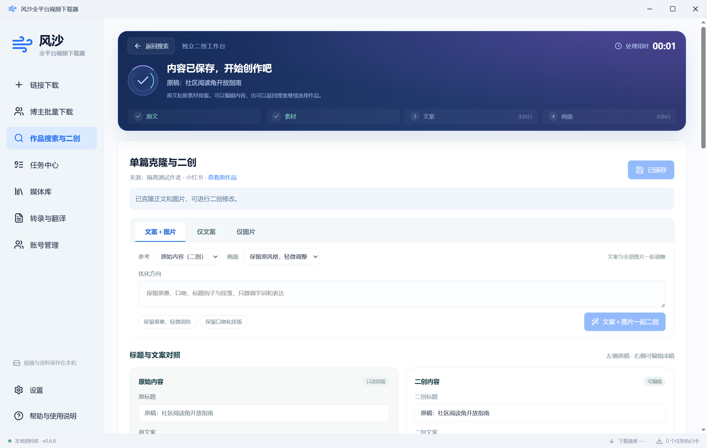
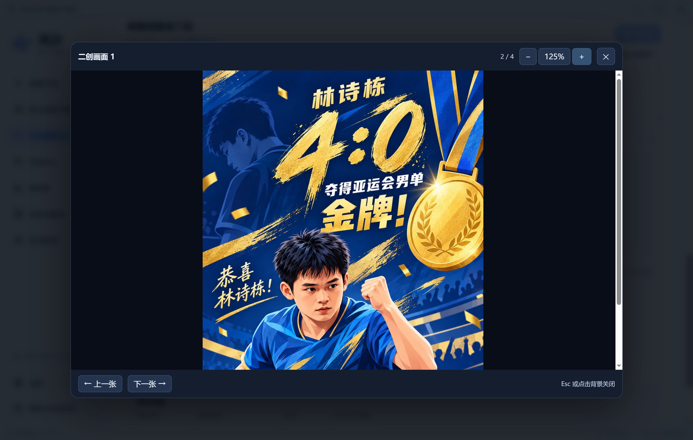
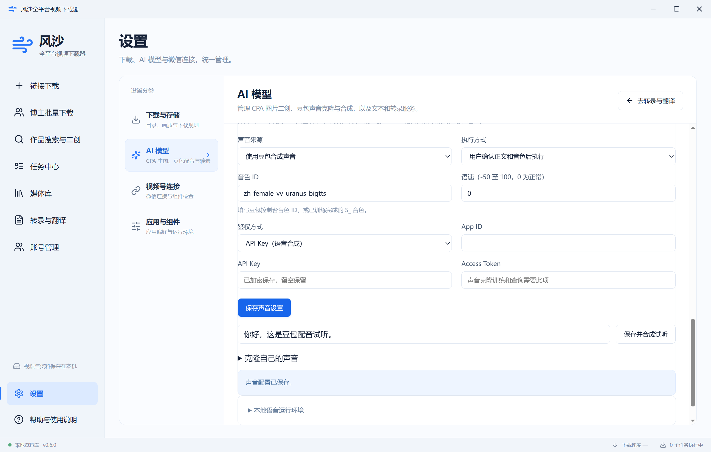
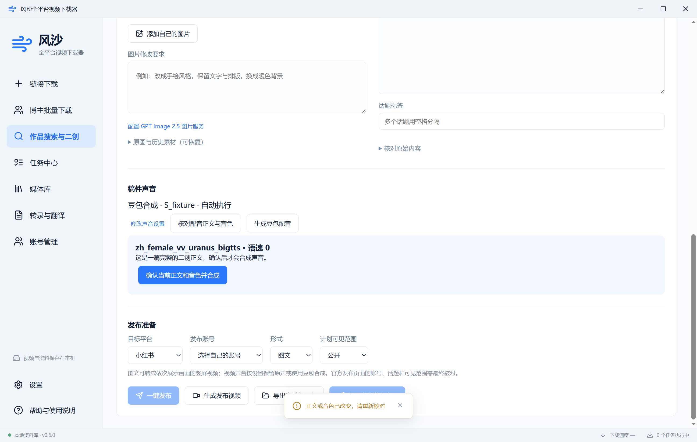

# 作品搜索、二创发布与评论联系（0.6.9）

本版本按参考录屏中的实际操作整理为两条流程：**搜索作品 → 克隆单篇 → 修改文案和画面 → 发布**；**选中作品 → 采集评论 → 勾选用户 → 单独或批量联系**。

## 1. 按关键词找作品

进入左侧“作品搜索与二创”，选择视频号、抖音、小红书、B站或 YouTube，输入关键词并搜索。

- 默认后台读取，**符合日期范围的作品逐批出现**，不必等待整次搜索结束。正在确认日期的条目不冒充最近一个月；可停止后选择作品克隆。
- 已登录时不会主动弹出采集窗口；需要登录或验证时自动显示，也可点击“显示官方窗口”。官网承载会话和验证，仍需保留在后台。
- 默认读取 **50 条、最近一个日历月**，数量和起止日期都可修改。一次搜索上限 500 条。
- 根据作品发布时间筛选；日期未返回时单独标注，默认不计入最近一个月。可勾选“同时列出日期未知作品”。
- 登录或验证在平台官方窗口完成。B站搜索先检查应用内账号；视频号需要电脑微信内的视频号页面和本机采集连接。
- 采集过程中，结果栏始终显示“停止采集，保留当前结果”。取得足够作品即可停止，不必等待达到上限；正在打开的日期详情也会终止。
- “继续读取”沿用有效位置；停止、失败和重启保留已取得记录。达到上限表示本次读取足够，不等于平台全部作品已读取。

后台采集过程中，已确认日期的作品实时展示。

上图为隔离测试数据，用于说明按钮位置；真实 YouTube 公开搜索示例如下。

### 视频号与抖音连接提示

视频号依赖已登录的微信客户端承载页面接口。搜索会先尝试使用已注册的 `weixin://dl/channels` 打开微信视频号；已连接时直接继续，不重复打开。等待时立即显示连接提示，提供“打开微信视频号”和“停止并保留结果”。微信版本不支持协议或未登录时，仍需官方登录或在微信内选择视频号；不能保证完全无需用户操作。只打开浏览器分享页不等于微信页面已连接。

抖音遇到官网验证码、登录或页面没有返回可读取作品时暂停并显示官方窗口，不将读取失败显示为“没有作品”；完成官方验证后继续。本次真实抖音环境停在验证码页，未完成真实结果采集验收。

YouTube 优先应用官网时间筛选，再按用户日期范围核验；列表只有“几个月前”等模糊日期时，最多使用一个后台详情读取器确认当前视频微格式中的确切日期，避免用猜测日期充数。结果逐批出现，可随时停止。

### 已保存会话为什么还需登录

“会话已保存”表示登录资料已在本机保存，不保证平台始终接受。0.6.8 启动恢复优先保留浏览器中更新的会话；账号登录与搜索共用同一会话和浏览器标识。小红书“完成登录”检查官方页面状态，不再把访客 Cookie 当成登录完成。若平台明确提示“电脑设备登录超限”，账号会标记为需要重新登录并说明原因；应在官方窗口完成登录再继续，不要反复新建账号或连续提交。已取得作品保持不变。

## 2. 单篇克隆并二创

点击某一篇的“一键克隆”，立即进入独立二创工作台，无需在搜索结果下方寻找编辑器。上方的光环动效、阶段和已等待计时持续显示；可停止处理或返回搜索，已取得内容保留。

正文和原图取得后逐步展示；二创文字以真实流式响应显示为预览，完整结束并校验后才保存。画面每完成一张就更新一张。取消、截断和失败不会用半截文案替换原稿。没有执行的二创步骤标注“未执行”。

“原作品／查看原作品”打开明确可见的独立官方窗口，沿用相应平台账号；失败会显示原因，手工关闭不误报加载失败。返回搜索保留未保存的编辑；克隆另一篇前会先保存当前修改。

图文笔记提取完整正文和原图片；视频进入原有转录流程，提取口播文字。**标题不会冒充完整正文**。

默认勾选“克隆后自动二创”：使用配置的文本及图片模型处理原稿。关闭时只取得原稿与素材，用户再填写方向。顶部“文案＋图片／仅文案／仅图片”为并列页签，每次选择一个范围。对应按钮同时处理两部分、只优化文案或只优化全部图片；另一部分保持不变，也可点击单张“AI 修改此图”。每个入口都有明确的参考依据：原稿／原图，或者当前成稿／当前图（再次创作、三创）。方向分别填写，不会把整篇方向偷偷套用到单张改图。空方向不触发手动生成，失败保留原稿和已完成部分。

左侧常驻原标题、原文案，右侧是可修改的二创标题、文案和话题。方法采用本项目的 [小红书轻微润色 Skill](../skills/xiaohongshu-remix/SKILL.md)：默认保留原意、诉求、叙述视角、标题钩子、情绪、段落与自然互动，仅微调字词；用户明确要求后才重组或扩写。不虚构来源、经历或新数据，不把参考材料评论、核查报告当发布正文；编辑提醒单独展示。短文不强行扩写，原始信息与必要限制保留。

原封面、每张原图与当前新画面逐一并排。可设置单张优化方向，多次编辑仍追溯同一原图；可以调整新图顺序、移除、恢复历史版本或添加自己的图片。历史图点击只放大，恢复必须点击独立的恢复按钮，避免误换画面。

所有改图入口默认局部轻调：保持摄影／插画风格、人物姿态、服装颜色、背景、版式与已有文字数量；不强制换画风、不塞入正文小字。清理来源媒体／账号署名、Logo、平台水印、二维码和服装器材的品牌标识，国旗等非品牌事实元素保留。“参考底图”默认始终参考原图，避免在错误生成图上越改越远；也可明确选择继续调整当前图。只有用户指定新风格／重构方向时才按方向重新设计。请求尺寸根据参考图的横竖比例选择，模型仍可能微调像素或细节。**提示约束不是自动版权鉴定，生成后仍需对照检查事实、画面标识及素材使用权限。**

视频自动二创先下载原视频并提取最多 8 张关键画面；这些画面可以分别改图，再生成依次展示画面的竖屏视频。**当前生成的是关键画面视频，不调用视频生成模型。声音按设置保留原声或用豆包合成二创正文；不属于逐帧视频重绘。**

编辑器允许修改标题、正文、话题、画面顺序，移除或添加自己的图片。原文、原图及历史图片保留，历史素材可以重新加入。生成的视频会与稿件版本关联：改稿后需重新生成，防止发布旧画面。

### 图片服务设置

在“设置 → AI 模型”配置 CPA 图片密钥。地址固定为 https://cpa.fengsha.online/v1；同一 CPA 服务器已有文本密钥时可复用。默认使用已实际成功改图的 `gpt-image-2.5-sunburst`；“保存并读取 CPA 图片模型”只展示 GPT Image 2.5 系列。不会回退到其他图片模型或其他服务器。

改图发送选定参考画面与方向到 CPA，不自动把正文印入图片；新标题仅在要求替换文字时使用。请求提交到 CPA 的 `POST /images/edits`，密钥在 Windows 本机加密保存，不进入文档、日志和仓库。0.6.7 用用户示例真实验证摄影轻调：保留人物、红金版式和主标题，清理底部来源标识与服装品牌，不新增小字；原图及历次版本保留。服务配置只在设置页操作，二创工作台不再放置配置链接。

### 点击图片与视频放大查看

应用内原图、新图、历史素材、头像和搜索封面均可点击放大。支持图片缩放、重置、同组上一张／下一张、Esc或背景关闭；关闭后恢复焦点和原页面位置。历史图片点击不会触发恢复或排序。

媒体库中的已下载视频点击封面可在大窗口播放，封面加载失败时仍可点击预览区域。已有原生视频的播放／进度／音量控件保留，并提供“放大视频”按钮。关闭预览停止新播放器，不继续后台出声。未取得可播放视频时只展示封面并明确说明，不把图片伪装成视频，不自动下载或调用模型。

### 视频声音设置

1. 在“设置 → AI 模型 → 视频声音”选择“保留原声音”或“使用豆包合成声音”。保留原声不请求豆包；图文没有原音频时生成无声视频。
2. 合成声音填写豆包 API Key，或选择 App ID + Access Token。填写控制台音色 ID，默认音色为 `zh_female_vv_uranus_bigtts`，可改音色和语速。
3. 选择“选定音色后自动执行”：视频自动二创结束后会合成，生成发布视频时也会生成／复用当前正文配音。
4. 选择“用户确认正文和音色后执行”：在稿件点“核对配音正文与音色”，核对完整正文、音色、语速，再点“确认当前正文和音色并合成”。确认之前不发合成请求。
5. 配音生成后可试听，再生成发布视频。修改正文、音色或执行策略会使旧确认和旧视频失效，避免发布过期声音；原声音始终保留。

展开“克隆自己的声音”，填写控制台已分配的 `S_` 音色槽位、App ID、Access Token，以及样本实际朗读的文字。选清晰的人声音频后明确提交；至少 5 秒，最多使用开头 60 秒，自动转换为单声道 24kHz WAV。提交后查询训练状态；训练未完成时不可合成。相同样本已提交或结果不明时先查状态，不重复训练。训练成功后“选择此音色”并保存设置。

豆包真实声音服务仍需用户在设置页配置凭据、开通合成／复刻权限；本次验证了隔离协议、实际音频预处理、试听和成片音轨，未执行真实豆包训练或合成。试听和训练按钮会调用所选服务并消耗对应额度。接口依据：[豆包 V3 HTTP 合成](https://docs.volcengine.com/docs/DoubaoVoice/unidirectional-streaming-text-to-speech-http?lang=zh)、[豆包官方复刻音色提交示例](https://docs.volcengine.com/docs/DoubaoVoice/End-to-endreal-timespeechlargemodelAPIaccessdocument?lang=zh)。

### 官方页面加载失败

0.6.4 已复现并修复小红书 ERR_FAILED：官方规范化跳转、末尾斜线和作品访问令牌均已处理。小红书 HTTP CDN 图片会转为 HTTPS，WebP 原图会转换为本地 PNG。使用实际账号读取及日期筛选、正文图片克隆均已验证。需要时在保留的官方窗口完成登录，再继续读取；无需关闭系统代理。详情见 [0.6.4 验收](验收-0.6.4.md)。

## 3. 发布到自己的账号

选择目标平台、自己的发布账号、图文或视频形式，以及公开或仅自己可见，点击“一键发布”。视频尚未生成时会先生成当前稿件的视频，再打开该账号的官方发布窗口、填入素材与文案，尝试提交。

- 小红书、抖音可选择图文或视频；B站、YouTube、视频号的本入口使用视频。图文仍可导出到其他发布入口。
- 若官方页面要求登录、额外设置，或上传／标题／正文／可见范围未能完整确认，流程停留在官方窗口，显示具体原因。可以手动完成。
- 也可使用“打开官方发布窗口”“填入素材与文案”“发布当前稿件”分步操作。
- 只有官方页面明确返回成功才记录成功。已点击但无法确认时标为待核对，同一稿件版本和账号不会自动重复提交。
- 真实平台的多步表单、账号权限、审核、验证码会影响自动发布；**本次没有向真实账号发布测试作品**，不能把隔离表单测试等同五平台正式发布验收。

## 4. 采集所选作品的评论和评论者

点击“一键采集评论”，立即进入独立的**评论与用户采集**页面。默认最多 50 条，可修改上限，分批继续；每批结果到达就显示，无需等全部完成。顶部展示等待时间、状态、评论数、可识别用户数、回复数和身份未返回数。

- **评论视图**：逐条展示头像、昵称、正文、主评论／回复、时间和地区；资料未返回时明确标注。
- **用户视图**：同一稳定用户 ID 的评论合并，可查看主页和逐位联系。
- **筛选**：输入昵称、评论关键词、地区或用户 ID，只过滤已取得的本机结果，不重新请求平台。
- **停止／继续**：中断后保留评论与读取位置；提高上限后继续。返回搜索保留结果，可从标题旁“打开评论采集结果”重新进入。
- **官网窗口**：普通采集在后台运行；官方登录或验证需要处理时才自动显示，也可点“显示评论窗口”手动查看。

同一用户的多条评论合并展示；用户身份未返回时保留评论正文，不能根据昵称猜测主页。视频号通过采集服务分页读取评论及回复；其他平台从官方评论页面读取。官方页面没有明确末页时不会显示“全部完成”。隐藏、删除、未加载或无权访问的评论不在承诺范围内。

“导出评论与用户资料”保存本机 JSON，评论和用户与当前结果一致，不包括账号凭据或尚未显示的缓冲条目。记录可在重启后恢复。平台公开资料不等于电话、微信号、邮箱等私密联系方式，本工具不推断这些字段。

## 5. 单独和批量私信

**单独发送**：在评论或用户视图中，直接点击该用户旁的“发送私信”。弹出独立面板，选择同平台账号并编辑模板；点击“预览并准备私信”，核对接收者与内容后点击“发送这条私信”。无需先全选用户。

**批量发送**：逐个勾选，或点击“全选全部用户／全选当前结果”；“取消全选”清空全部选择。同一用户的多条评论共享选择，匿名或没有稳定主页的条目不可勾选联系。在“账号与文案”选择同平台账号、模板及3–60秒间隔，点击“批量发送私信”。预览页面明确列出本次所选用户和每位实际文案，再点击“发送所选用户”。结果逐位更新，可停止、继续未发送用户；遇到登录／验证、没有入口或接收者无法核对时暂停。

模板支持 `{昵称}`、`{评论}`、`{作品}`。采集、勾选或预览不自动发送；已经尝试的同账号／用户／文案会标记“不重发”，不能把未知送达结果当作失败再自动发送。

仅当官方网页提供私信入口、能核对稳定接收者和消息输入框时才自动填入、提交。公开评论框、搜索框不会当作私信输入框；点击发送前再次核对接收者和实际输入文本，若页面异步切换或文案被覆盖则暂停。缺少网页入口时保留文案并复制，供在官方客户端联系。不会把主页上的“关注”“评论”误当私信；送达不明时禁止自动重试。**各平台的网页私信可用性不同，未完成五平台真实私信验收。**

## 6. 已验证和仍需验证

| 项目 | 本次证据 |
|---|---|
| 默认 50 条／最近一个月、日期与作品身份校验 | 自动测试通过 |
| 小红书图文搜索、正文／原图克隆、改图、改文案、导出 | 隔离官方页面与模型响应测试通过 |
| 视频生成 | 实际 FFmpeg 生成与 FFprobe 校验通过；豆包隔离响应音轨实际拼接 |
| CPA 图片改图 | GPT Image 2.5-sunburst 真实出图并保留原图 |
| 豆包确认／自动／保留原声、克隆协议与训练状态 | 隔离协议与真实音频预处理通过；尚未真实调用豆包 |
| YouTube 关键词视频搜索 | 真实公开网络返回 5 条符合范围的视频 |
| 评论去重、视频号根评论／回复、上限缓冲、大整数、重启恢复 | 隔离测试通过 |
| 素材填入、可见范围、成功识别、发布防重复 | 隔离官方表单测试通过；未实际对外发布 |
| 核对评论者并提交私信、防重复 | 隔离官方聊天页面测试通过；未联系真实用户 |
| 其他平台真实搜索、真实豆包语音、正式发布／私信 | 仍需有效登录、模型配置及平台实际许可验证 |

## 开源方案参考

研究了 [xiaohongshu-mcp](https://github.com/xpzouying/xiaohongshu-mcp) 的笔记详情、评论及发布流程，[social-auto-upload](https://github.com/dreammis/social-auto-upload) 的各平台官方发布方式，以及 [wx_channels_download](https://github.com/ltaoo/wx_channels_download)／[wx_channel](https://github.com/nobiyou/wx_channel) 的微信页面采集适配。采用已有登录会话和官方窗口，不把开源项目的支持列表当成本应用的真实验收结果。

补充实测：正式桌面抖音会话要求官方登录／验证，已返回 needs-action；微信本机组件已成功准备并重载搜索扩展，真实关键词搜索仍需微信页面加载该扩展，尚未宣称通过。
