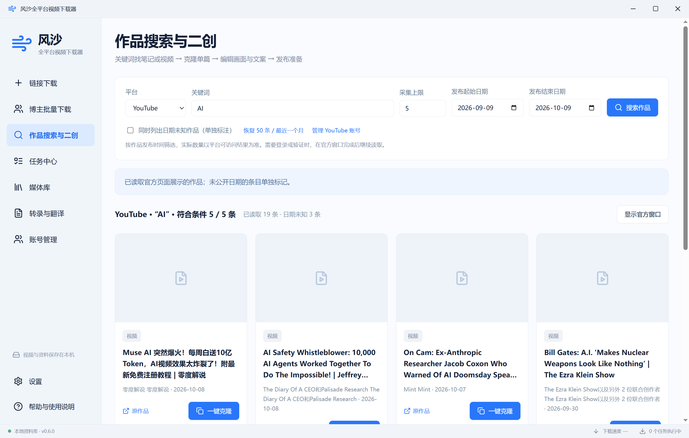
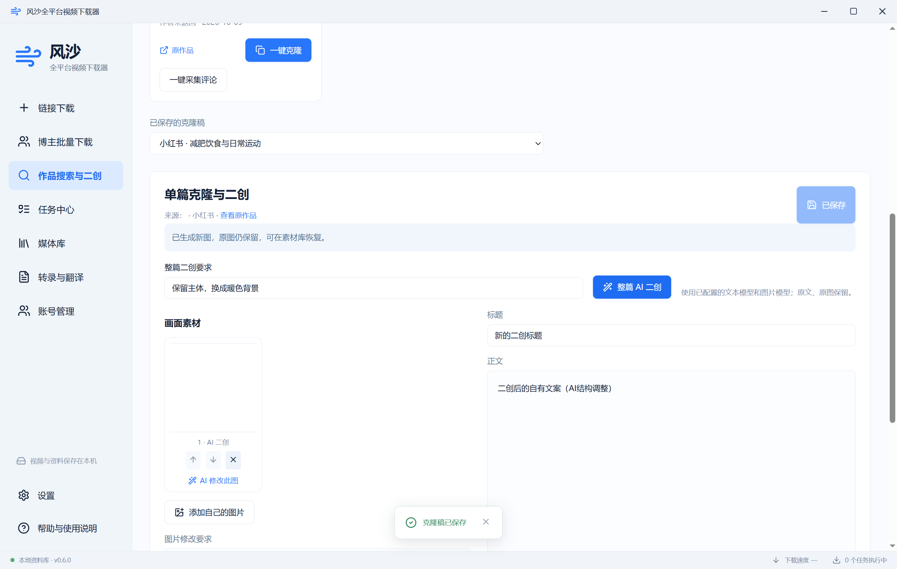
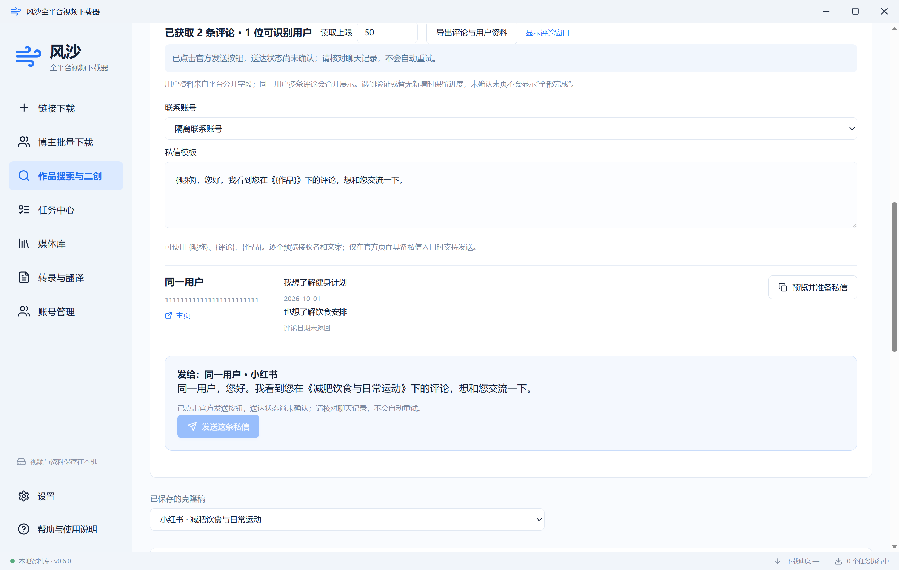

# 作品搜索、二创发布与评论联系（0.6.0）

本版本按参考录屏中的实际操作整理为两条流程：**搜索作品 → 克隆单篇 → 修改文案和画面 → 发布**；**选中作品 → 采集评论 → 核对评论者 → 逐条联系**。

## 1. 按关键词找作品

进入左侧“作品搜索与二创”，选择视频号、抖音、小红书、B站或 YouTube，输入关键词并搜索。

- 默认读取 **50 条、最近一个日历月**，数量和起止日期都可修改。一次搜索上限 500 条。
- 根据作品发布时间筛选；日期未返回时单独标注，默认不计入最近一个月。可勾选“同时列出日期未知作品”。
- 登录或验证在平台官方窗口完成。B站搜索先检查应用内账号；视频号需要电脑微信内的视频号页面和本机采集连接。
- “继续读取”沿用有效位置；停止、失败和重启保留已取得记录。达到上限表示本次读取足够，不等于平台全部作品已读取。

上图为隔离测试数据，用于说明按钮位置；真实 YouTube 公开搜索示例如下。

## 2. 单篇克隆并二创

点击某一篇的“一键克隆”。图文笔记提取完整正文和原图片；视频进入原有转录流程，提取口播文字。**标题不会冒充完整正文**。

默认勾选“克隆后自动二创”：已配置的文本模型改写标题、正文和话题；已配置的图片模型对画面生成新图。关闭该选项可先克隆原稿，再点击“整篇 AI 二创”。模型未配置时保留原稿并提示配置，不伪造生成结果。

视频自动二创先下载原视频并提取最多 8 张关键画面；这些画面可以分别改图，再生成依次展示画面的竖屏视频。**当前生成的是关键画面视频，沿用原声音；修改正文不会生成新的口播，也不是逐帧视频重绘。**

编辑器允许修改标题、正文、话题、画面顺序，移除或添加自己的图片。原文、原图及历史图片保留，历史素材可以重新加入。生成的视频会与稿件版本关联：改稿后需重新生成，防止发布旧画面。

### 图片服务设置

在设置的 AI 模型页配置图片服务地址、API 密钥和模型。官方默认模型为 `gpt-image-2.5-sunburst`，也可以填写兼容服务实际支持的名称。

服务须支持 `POST /images/edits`、multipart 原图和 base64 图片返回。密钥加密保存在本机，不写入源码、日志或 GitHub。改图请求会把所选图片和修改要求发送到配置的服务，并消耗该服务额度。

协议依据：[OpenAI 图片生成与编辑文档](https://developers.openai.com/api/docs/guides/image-generation)。本次验证了请求格式与结果处理；当前桌面未配置图片服务密钥，未完成真实 GPT Image 出图验收。

## 3. 发布到自己的账号

选择目标平台、自己的发布账号、图文或视频形式，以及公开或仅自己可见，点击“一键发布”。视频尚未生成时会先生成当前稿件的视频，再打开该账号的官方发布窗口、填入素材与文案，尝试提交。

- 小红书、抖音可选择图文或视频；B站、YouTube、视频号的本入口使用视频。图文仍可导出到其他发布入口。
- 若官方页面要求登录、额外设置，或上传／标题／正文／可见范围未能完整确认，流程停留在官方窗口，显示具体原因。可以手动完成。
- 也可使用“打开官方发布窗口”“填入素材与文案”“发布当前稿件”分步操作。
- 只有官方页面明确返回成功才记录成功。已点击但无法确认时标为待核对，同一稿件版本和账号不会自动重复提交。
- 真实平台的多步表单、账号权限、审核、验证码会影响自动发布；**本次没有向真实账号发布测试作品**，不能把隔离表单测试等同五平台正式发布验收。

## 4. 采集所选作品的评论和评论者

点击“一键采集评论”，默认最多 50 条，可修改上限，分批继续。读取公开评论、可访问回复、昵称、稳定用户 ID、主页、头像，以及平台已返回的时间／地区字段。

同一用户的多条评论合并展示；用户身份未返回时保留评论正文，不能根据昵称猜测主页。视频号通过采集服务分页读取评论及回复；其他平台从官方评论页面读取。官方页面没有明确末页时不会显示“全部完成”。隐藏、删除、未加载或无权访问的评论不在承诺范围内。

“导出评论与用户资料”保存本机 JSON。记录可在重启后恢复。平台公开资料不等于电话、微信号、邮箱等私密联系方式，本工具不推断这些字段。

## 5. 逐位联系

选择同平台的联系账号，编辑模板，支持 `{昵称}`、`{评论}`、`{作品}`。在某位用户旁点击“预览并准备私信”，核对接收者及内容后点击“发送这条私信”。

仅当官方网页提供私信入口、能核对稳定接收者和消息输入框时才自动填入、提交。缺少网页入口时保留文案并复制，供在官方客户端联系。不会把主页上的“关注”“评论”误当私信；送达不明时禁止自动重试。**各平台的网页私信可用性不同，未完成五平台真实私信验收。**

## 6. 已验证和仍需验证

| 项目 | 本次证据 |
|---|---|
| 默认 50 条／最近一个月、日期与作品身份校验 | 自动测试通过 |
| 小红书图文搜索、正文／原图克隆、改图、改文案、导出 | 隔离官方页面与模型响应测试通过 |
| 视频生成 | 实际 FFmpeg 生成与 FFprobe 校验通过 |
| YouTube 关键词视频搜索 | 真实公开网络返回 5 条符合范围的视频 |
| 评论去重、视频号根评论／回复、上限缓冲、大整数、重启恢复 | 隔离测试通过 |
| 素材填入、可见范围、成功识别、发布防重复 | 隔离官方表单测试通过；未实际对外发布 |
| 核对评论者并提交私信、防重复 | 隔离官方聊天页面测试通过；未联系真实用户 |
| 其他平台真实搜索、真实模型出图、正式发布／私信 | 仍需有效登录、模型配置及平台实际许可验证 |

## 开源方案参考

研究了 [xiaohongshu-mcp](https://github.com/xpzouying/xiaohongshu-mcp) 的笔记详情、评论及发布流程，[social-auto-upload](https://github.com/dreammis/social-auto-upload) 的各平台官方发布方式，以及 [wx_channels_download](https://github.com/ltaoo/wx_channels_download)／[wx_channel](https://github.com/nobiyou/wx_channel) 的微信页面采集适配。采用已有登录会话和官方窗口，不把开源项目的支持列表当成本应用的真实验收结果。

补充实测：正式桌面抖音会话要求官方登录／验证，已返回 needs-action；微信本机组件已成功准备并重载搜索扩展，真实关键词搜索仍需微信页面加载该扩展，尚未宣称通过。
