# 风沙全平台视频下载器 0.6.5

0.6.5 增加独立克隆工作台、动态阶段与等待计时、真实流式文案及独立原作品窗口；此前优化后台搜索与逐批显示结果；此前增加 CPA GPT Image 2.5 统一生图、豆包语音克隆／配音设置及确认流程；视频仍采用关键帧改图后拼接。此前新增“作品搜索与二创”，默认 50 条／最近一个月，支持单篇克隆、画面与文案二创、官方发布、评论采集和逐位联系。详细图文步骤与实际验证范围见 [作品二创与评论采集](作品二创与评论采集.md)。

这是一个 Windows 桌面下载、转录与翻译应用。0.4.0 新增可供 Agent 调用的 CLI，下载、媒体、账号、文案和统一设置继续保留。命令使用见 [CLI 与 Agent 使用说明](CLI使用说明.md)。首次安装或源码构建见 [安装部署](安装部署.md)。

本文截图来自 0.4.0 的隔离演示资料，使用合成视频、样例账号和模拟 AI 服务；不展示真实账号和密钥，也不作为真实平台全量采集的证明。

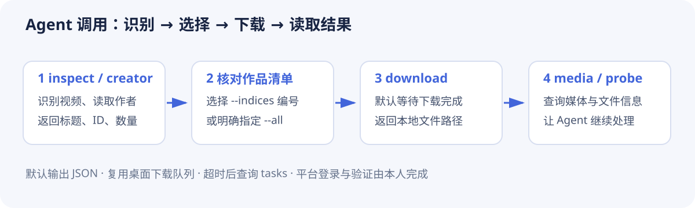

## 一眼看懂各入口

| 入口 | 做什么 |
| --- | --- |
| 链接下载 | 粘贴单个或批量作品链接，识别并下载 |
| 用户搜索 | 关键词搜索五平台用户，核对身份后进入博主读取 |
| 博主批量下载 | 识别博主、读取作品、勾选下载 |
| 任务中心 | 下载排队、进度、暂停与重试 |
| 媒体库 | 播放、定位文件；点击“转录与翻译”处理素材 |
| 转录与翻译 | 按目录管理素材，原文与 AI 矫正并排核对，多语言翻译 |
| 账号管理 | 在官方窗口登录平台；与 AI 模型配置分开 |
| 设置 → AI 模型 | 配置文本模型，选择本地或在线语音 |
| 设置 → 视频号连接 | 内置组件连接微信，任务结束恢复原网络 |

## 关键词搜索用户

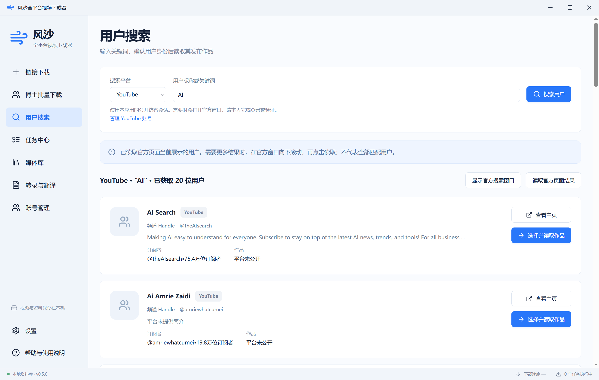

选择平台 → 输入关键词 → 搜索用户 → 核对主页和用户 ID → 选择并读取作品。需要时先在官方窗口完成登录或验证；粉丝数、作品数未返回时明确显示平台未公开。搜索不会自动下载，完整条件与异常处理见 [用户搜索说明](用户搜索.md)。上图为 YouTube 真实公开网络结果，其他平台的验收范围在说明中单独列明。

## 转录与翻译

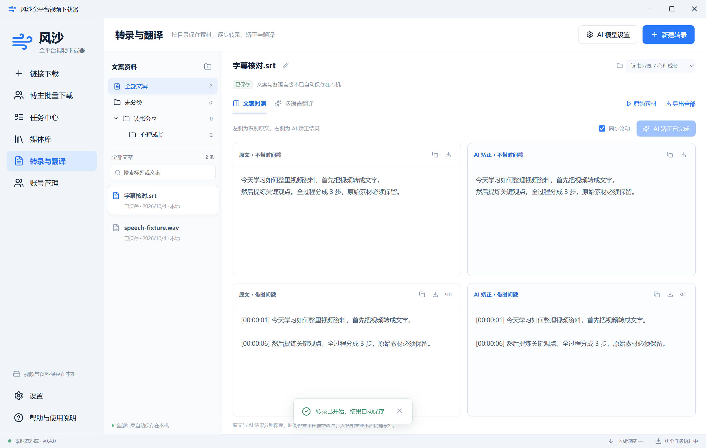

左侧按目录整理素材，右侧上下两行分别对应纯文本和时间戳。以下步骤按顺序独立执行。

1. 左侧点击文件夹加号建立目录；选中目录后再次点击可建立子目录。例如“读书分享 / 心理成长”。选中父目录可同时查看其子目录的素材；全部文案与未分类也可直接查看。搜索包含原文、矫正文案和译文。目录可重命名，素材在“所属目录”中移动，结果自动保存。
2. 点击“新建转录”，选择视频或播客链接、已下载媒体、本地文件或字幕，也可以粘贴文稿。新任务默认简体中文；非中文音频可切换语言或自动识别。仅转录不需要文本模型。
3. 点击“开始转录”后，左上输出不带时间戳原文，左下输出带时间戳原文。纯文本素材没有真实时间戳时明确标注，不编造时间位置。
4. 点击“AI 矫正”，同时生成不带时间戳与带时间戳的矫正文案，分别显示在右上和右下。时间戳沿用原始字幕位置；模型只修改文字。可同步滚动同类文案。核对原文和矫正结果，人名、专业术语仍需检查。
5. 打开“多语言翻译”，选择识别原文或 AI 矫正文案，再选择不带时间戳或带时间戳。可多选英语、日语、韩语、法语、德语、西班牙语和简体中文，点击“AI 翻译”才开始。各语言并排显示，语言较多时横向滚动。纯文本翻译输出纯文本；时间戳翻译保持每一段的原始起止位置。
6. 不同来源、格式和语言分别保存。再次打开或重启后结果保留；失败可继续处理，已完成语言和分段尽量复用。旧结果在新结果成功前保留。转录、矫正和翻译不会一起自动执行。
7. 文案面板右上角支持复制和 TXT 导出；带时间戳文案还支持 SRT。点击“导出全部”导出包含原文、矫正结果和各语言版本的 Markdown。新界面不提供摘要、笔记或归档确认。旧版摘要、笔记、人工确认稿与草稿仍保存在本机；已有完整旧资料可通过导出全部查看。旧记录可点击“补齐时间戳矫正”生成成对结果。

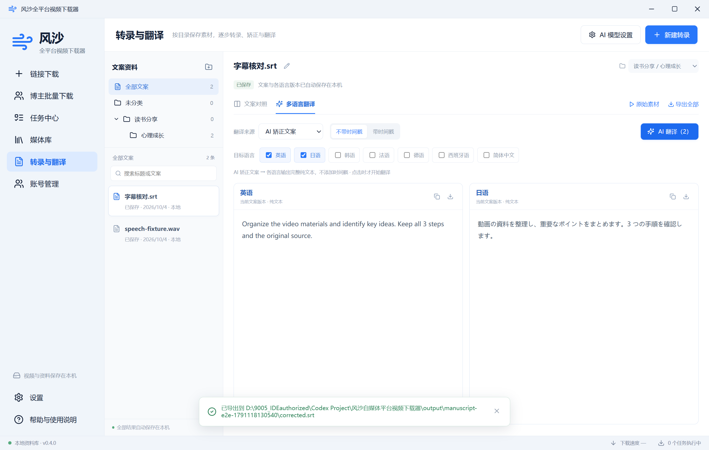

翻译页面按语言分别显示，可选择来源与格式，再复制或导出。图中译文来自模拟服务。

### 配置 AI 与语音

在“设置 → AI 模型”填写 CPA 地址与 API 密钥，默认 `https://cpa.fengsha.online/v1`；点击“保存并读取模型”，选择或填写模型名称，再测试连接。配置可修改，文本模型用于矫正与翻译。模型目录不代表每个模型都支持语音。

密钥只在本机 Windows 加密文件保存，不进入 SQLite、页面存储和日志。更换服务域名需重新填写密钥。新安装默认本地 small，升级保留已有选择；base 速度优先，small 更适合中文。运行环境与两个模型随包提供。在线语音需要支持 `audio/transcriptions`；CPA 未提供语音接口时可使用本地转录。选择在线语音会把音频发送到配置服务，AI 矫正与翻译会发送文案。

链接优先读取源字幕，缺失时下载音频转录。长音频按 10 分钟分段，长文稿根据模型输出额度分段。模型漏段、乱序、明显缩写或输出截断时不会保存为完整结果，可重试。检查不能证明所有文字均正确。在线语音没有返回逐句时间时只能使用音频分段时间；不会根据 AI 文案推测新的时间戳。原素材保留，无自动删除任务。

## 下载视频

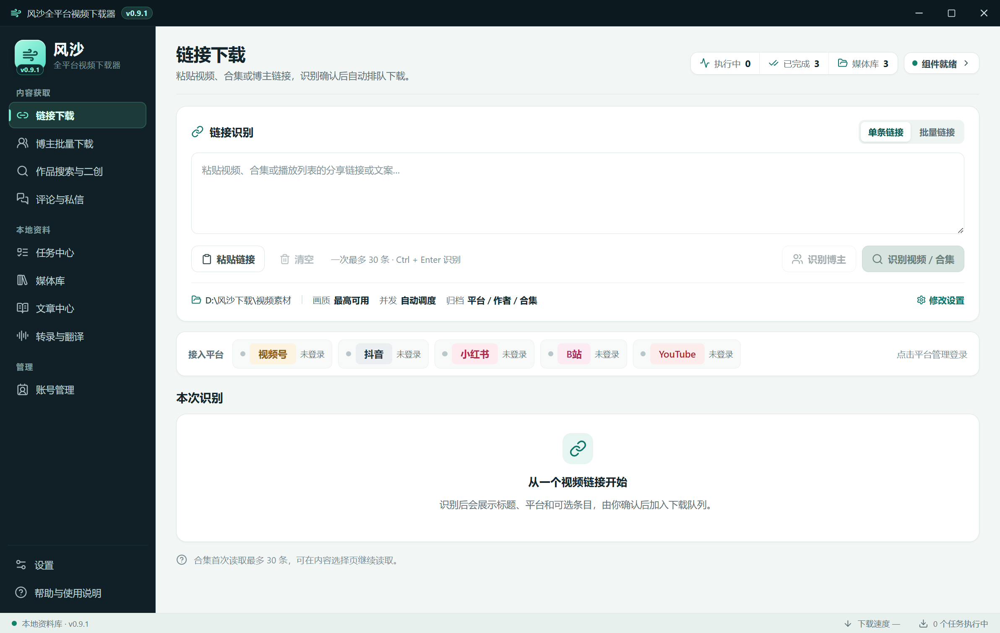

粘贴分享链接或文案后，先识别再选择内容。

1. 在“链接下载”粘贴视频链接或含链接的分享文案，点击“识别视频 / 合集”。
2. 查看识别结果，进入“内容选择”。选择需要的视频、画质和保存位置。
3. 点击“加入下载队列”，在“任务中心”查看下载、合并与校验进度。
4. 完成的视频会加入“媒体库”。点击“播放”使用电脑的默认播放器；点击“定位文件”打开文件所在位置。

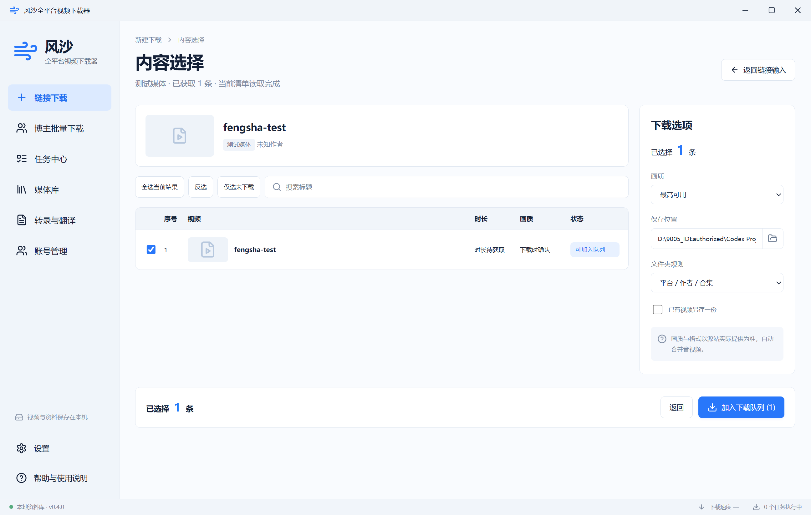

内容选择页核对标题、画质、保存位置与归档方式；一次选择超过30条会提示确认。

合集默认先读取最多 30 条。清单可能不完整时，可以主动读取更多，最多 300 条。选择超过 30 条时需要再次确认下载数量。不同平台能提供的集合类型不同，不保证主页或每个合集均可解析。

## 读取博主作品与批量下载

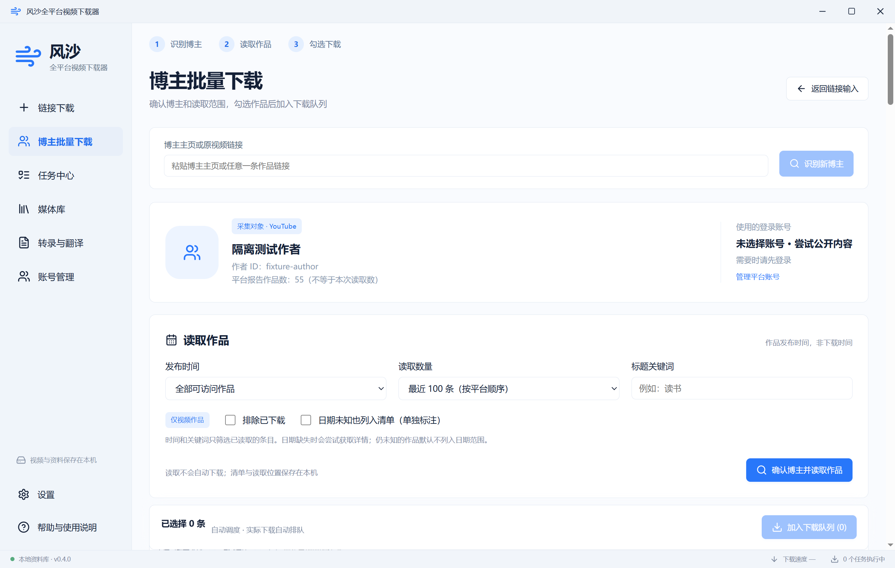

图中为 CLI 读取后在同一桌面资料库展示的隔离样例，页面保留作者、读取数、筛选数和作品勾选。

1. 打开“博主批量下载”，粘贴一个视频链接或博主主页链接，点击“识别博主”。不要只输入昵称。
2. 核对采集对象的平台、昵称和作者 ID。视频号右侧展示微信连接方式；其他平台展示你自己的登录账号，与采集对象分开展示。
3. 设置最近 7/30/90 天、自定义日期或全部可访问作品；选择读取 50/100/自定义条数或持续读取至平台末页。可加标题关键词、排除已下载、包含日期未知作品。
4. 点击“确认博主并读取作品”。清单每页最多读取 50 条，显示原始读取数量和筛选后的数量。达到数量上限可继续读取 50 条；可随时停止，已读清单和游标保留，下次启动可继续。
5. 勾选作品或“全选当前未下载”，点击“加入下载队列”。点击加入队列后直接提交，应用每 200 条分批提交；队列总数量不设固定上限，仍受可用磁盘和内存限制。

时间与关键词过滤只作用于本次读取的条目。例如读取最近 50 条后筛出 6 条，不代表该作者只有 6 条符合范围的作品；需要时扩大读取数量。日期缺失时尝试逐条获取详情；仍未知时默认不计入时间范围，可以主动选择包含并查看“发布时间未知”标注。范围改变后应重新确认读取，继续读取沿用该清单已保存的条件。

### 当前博主能力

| 平台 | 当前状态 |
| --- | --- |
| YouTube | 已实测从公开视频识别 Blender 频道，读取其发布清单。视频、Shorts 和公开回放通过上传列表读取；登录验证或请求限制仍可能中断。未宣称已遍历该账号全部作品。 |
| B站 | 视频或主页确定原作者 UID；作品列表采用原生签名分页。当前访客列表受限，本应用官方主页要求登录，登录后的全量作品待实测。 |
| 抖音 | 已实测从公开视频识别原作者、读取主页展示作品，并下载真实 MP4。支持分享文案、短链接、视频链接和主页链接；通过工具自己的官方网页会话取得作品信息与下载格式。仅读取发布作品，图文与受限内容不作为视频下载。登录或验证需要时在官方窗口完成。不能保证覆盖全部作品。 |
| 小红书 | 实验接入：打开官方主页，从发布笔记列表读取标识为视频的可见作品，保留分享所需参数。真实账号全量与下载尚未验收。 |
| 视频号 | 内置微信连接组件。博主作品通过微信读取并直接下载，不要求逐条经元宝解析。保留稳定作者 ID、头像、作品封面、日期和平台返回的总数；平台未返回总数时明确显示未知。完整读取、勾选、加密视频下载及解密播放流程已用隔离测试接口验证；当前用户的真实微信作者列表与下载仍须微信连接后验收。原有已登录元宝的单视频下载继续可用。 |

抖音、小红书官方窗口不要切换到其他博主、搜索结果、收藏或点赞页。读取只针对发布作品容器；页面显示到末页仍会标明“覆盖范围待验证”，不会把可见链接清单当成账号完整清单。关闭窗口后继续读取会重新打开该主页。

抖音使用“识别博主 → 确认博主并读取作品 → 勾选 → 加入下载队列”。无需逐条播放；下载时自动刷新所选视频的信息。仅需抖音官方页面正常可访问，不需要微信采集代理，也不需要 AI 模型。分享短链接若跳回抖音首页而未返回原视频，请从抖音重新复制分享文案，或直接粘贴博主主页地址。

### 视频号：按任务自动连接与恢复

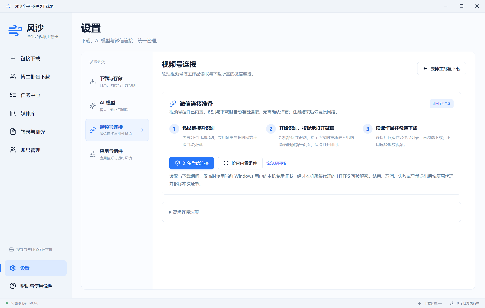

图中“组件已准备”使用测试状态展示界面，不表示已连接真实微信。

1. 在“博主批量下载”粘贴原视频或主页链接，点击识别。程序自动启动内置组件并临时处理专用证书与代理，不弹确认窗口。
2. 若需要检查组件，可在“视频号连接”点击“准备微信连接”；不会提前切换系统代理。
3. 到“博主批量下载”粘贴原分享链接并识别。出现“请重新进入微信视频号页面”时，在微信关闭并重新进入视频号页面；桥接连接成功后工具自动继续。微信登录、扫码或验证仍在微信完成。
4. 核对作者，读取作品并勾选下载。多个并发任务共用连接，最后一个任务结束、停止或失败后恢复原代理，并移除本次临时导入的证书。程序意外退出时由独立 Windows 守护处理，重启时再检查未完成的恢复记录。
5. 未使用该功能时保持原网络。恢复失败会阻止新的自动连接任务，可在“视频号连接”点击“恢复原网络”。你在连接期间手动换了其他代理时，恢复不会覆盖你的新选择。原本已存在的同一证书不由本工具移除。

当前使用自动代理脚本或复杂分协议代理时，工具不会覆盖它。高级选项可关闭自动切换，使用你已配置好的本机服务；手动模式不更改代理或证书。“组件已准备”仅表示本机接口可达，必须取得真实微信连接才能读取作品。

“平台报告作品数”“已读取”“筛选后”分别表示平台元数据、实际取得清单、满足当前条件的清单。未返回总数显示尚未取得，不用 0 冒充作者没有视频；平台返回末页仍只代表当前可访问范围。

## 自动排队与并发

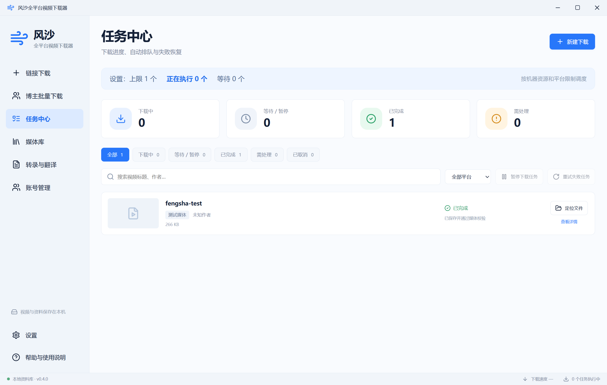

在任务中心核对执行、等待、完成与失败状态；CLI 的 tasks 返回同一套记录。

设置“同时下载”可选自动模式或上限 1—99。99 表示允许的上限，不代表启动 99 个传输。实际启动数量由处理器数量、空闲内存、处理器负载、合并任务和平台限制共同决定；其余任务等待。任务中心显示正在执行、等待数量与平台冷却状态。

当前单个平台并发保护上限：YouTube 4、B站 3、视频号/抖音/小红书 2。平台返回限流时该平台暂缓新任务并等待冷却；网络错误会短暂等待。已运行任务不会因为降低设置或机器繁忙而被强制中止。示例：测试环境设置上限 99，加入 500 条任务，资源预算允许 4 条时实际执行 4 条、等待 496 条。

## 平台与账号

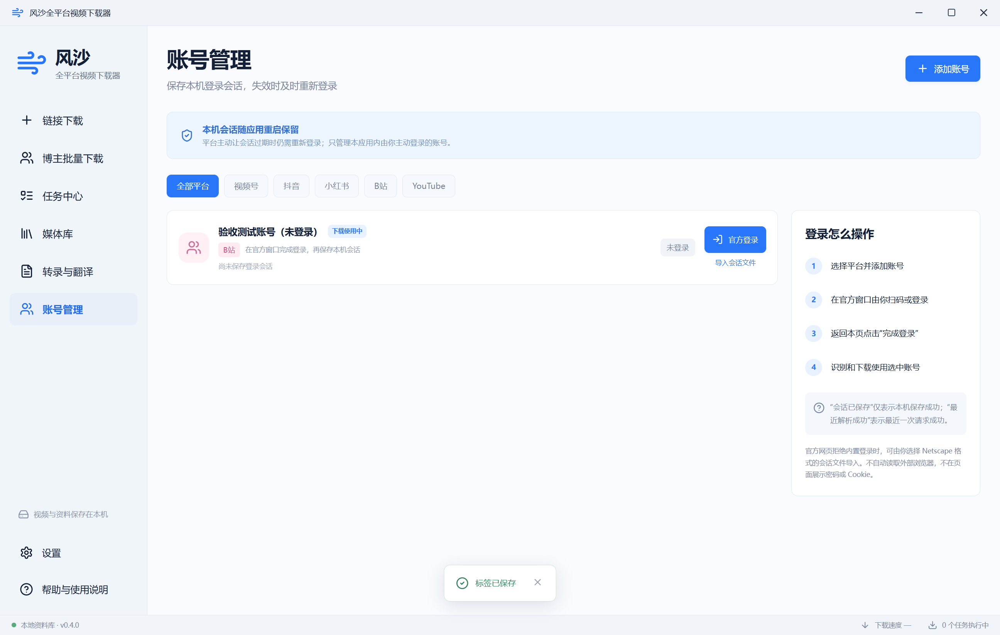

截图中样例账号没有真实登录。添加账号后，在官方窗口由本人完成登录。

首批接入 YouTube、B站、抖音、小红书和视频号。名称“全平台”是产品名称，不能理解为每个平台、每条链接、每种画质都能下载。

在“账号管理”添加平台账号和备注，点击“官方登录”，由你在官方网页完成扫码或账号登录。回到“账号管理”点击“完成登录”。同一平台可以添加多个独立账号，并选择一个“下载使用中”的账号。

其他平台使用本应用管理的独立登录会话，不读取旧软件或外部浏览器的账号。视频号作者作品使用当前微信视频号连接；本机版本按任务自动临时切换专用证书和代理。会话失效时需在官方窗口重新登录。

“会话已保存”表示本机保存成功；“最近解析成功”表示最近一次解析请求成功，不能保证所有内容都能访问。下载返回明确的登录错误时，会标记相应账号“需要重新登录”。更新登录后可返回任务中心重试。

视频号博主清单内的作品使用微信连接获取实时下载参数，不在资料库保存媒体签名地址或解密参数。原有元宝账号仍可解析单条分享链接。平台接口变化可能导致读取失败；视频号恢复任务时重新下载，不承诺断点续传。

部分官方登录网页可能拒绝嵌入式浏览器。此时可在账号卡片点击“导入会话文件”，由你选择自己从该平台导出的 Netscape 格式 Cookie 文件。本应用只读取你主动选定的文件，不扫描外部浏览器。导入仅保存会话，实际有效性仍由解析和下载验证。

会话在本机使用 Windows 加密保存；会话 Cookie 在重启时恢复，原有有效期限不延长。会话变动会保存，明确过期或认证失败会引导重新登录。重新登录后，返回任务中心点击“登录后重试”。

## 文件与任务

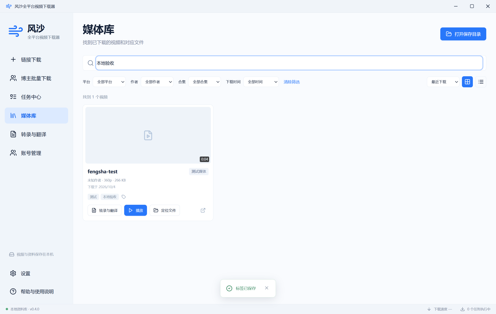

完成的视频在媒体库播放、定位、标记，也可以进入转录与翻译。

默认目录：源码版为项目的 `.local/下载视频`；安装版为程序目录上一级的“下载视频”。设置中可以改为其他目录。新安装默认采用自动调度；升级保留原有并发设置。网络错误最多自动重试 3 次；登录失效、内容失效、磁盘不足等问题需要处理后重试。

自动归档规则可选“平台 / 作者 / 合集”“平台 / 作者”或直接存放到指定目录。文件名前部包含稳定内容标识，B站分P分别管理，避免同标题冲突。源站格式由下载引擎决定，下载完成后自动合并并校验视频流。

暂停会停止当前传输。一般来源继续时尝试复用片段；视频号会重新下载。取消任务保留已完成的视频，不会清理其他应用文件。关闭窗口时仍有下载任务，会询问是否暂停退出。

重复视频只有在已有媒体文件仍存在时才跳过；可以在内容选择页选择“已有视频另存一份”。文件被移动时，媒体库显示“文件已移动或缺失”，可手动“重新定位”。

## 统一设置

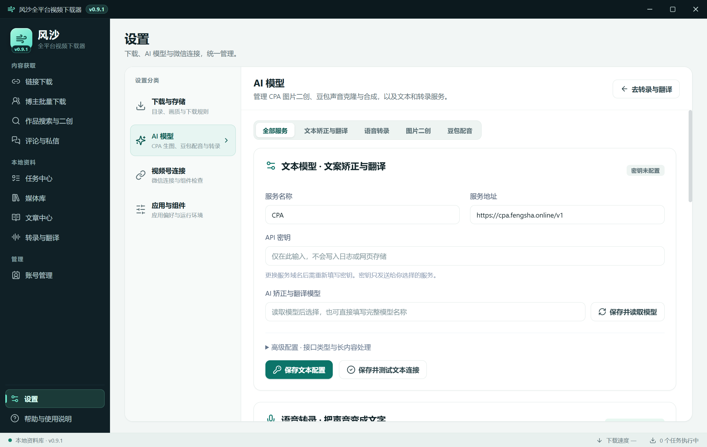

设置中分别管理下载与存储、AI 模型、视频号连接、应用与组件。切换分类保留未保存输入；需要实际生效时点击保存。

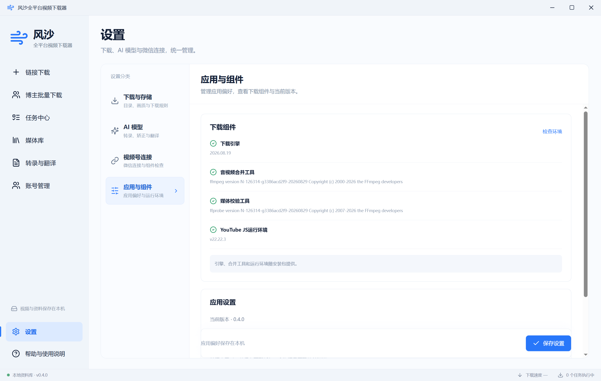

安装版或源码版组件缺失时先检查路径和版本，再开始平台下载。

## CLI 与 Agent

源码 Node 入口或安装目录的 fengsha-cli.cmd 支持 inspect / creator / download / tasks / media / probe。默认 JSON 输出、后台自动启动、与桌面共享队列；下载默认等待完成并返回文件路径。参数、清单选择、退出码和登录限制见 [CLI 使用说明](CLI使用说明.md)。

## 本地资料

当前版本：0.6.5。

`library.sqlite` 保存设置、任务、媒体与文案记录；平台账号独立会话在 `accounts` 下，AI 配置密钥使用单独的加密文件。下载与本地转录不需要文本 AI 密钥；AI 矫正与翻译需要自己配置服务。

备份前退出应用，复制完整用户数据目录及已下载文件。更换机器或 Windows 用户时，加密会话和密钥可能无法解密，需要重新登录和填写。升级同一版本链时保留既有资料，不能将空目录当作迁移成功。0.1.0 的历史目录是 `%APPDATA%\fengsha-video-downloader`，从该版本迁移需在退出旧版后备份、搬迁资料并核对媒体路径。

已有视频不会因更改保存目录而自动搬迁。新应用不写入旧软件的资料目录。不要把登录会话、用户数据库或 AI 密钥放进公开仓库、云端分享或源代码备份。

## 失败处理

| 提示 | 可操作恢复方式 |
| --- | --- |
| 需要登录 | 在账号管理完成登录，返回任务重试 |
| 请求受限 | 等待冷却、降低并发，必要时重新登录 |
| 链接失效 | 打开原页面，重新复制最新分享链接 |
| 网络中断 | 等待自动重试，或恢复网络后手动重试 |
| 磁盘空间不足 | 释放空间，或选择其他保存目录后新建任务 |
| 合并 / 校验失败 | 设置中检查环境，查看任务诊断信息后重试 |

任务详情中的诊断信息已隐藏完整 URL、Cookie 和认证字段。原画质、字幕、直播、付费内容、任意格式转换和所有站点覆盖不属于首版保证。

## B站封面、作品信息与受限处理（0.4.2）

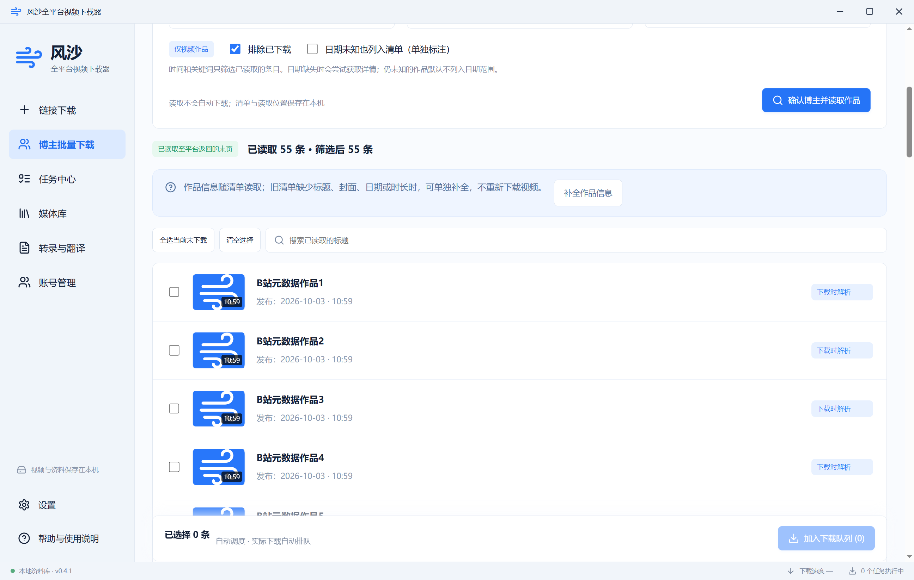

图中为隔离接口样例，用来展示完整标题、封面、发布日期和时长，不代表真实账号的完整历史已验收。

- 有效的 B站 HTTP / 协议相对封面升级为 HTTPS，保留界面的安全策略。图片暂时失败时显示占位；信息更新后能重新加载。
- 博主作品采用 B站原生页码与列表字段，每页最多30条；50 / 100条等读取上限仍保持原含义。不会为下一批重新遍历前面的作品。
- 旧清单已经出现“待获取标题”或缺少日期、时长、封面：打开“博主批量下载”，点击“补全作品信息”。每次最多补50条，仅获取缺失字段，不下载或覆盖视频。完成和中断后的进度保存，再次点击只处理仍缺失的条目。
- `352 / 412 / 401 / 799` 作品接口拒绝会显示中文提示，列表请求冷却一分钟。需要时在“账号管理”登录 B站、完成官方验证，等待后点击“继续读取”。冷却期间不会再次提交该博主列表请求。
- 重新读取第一批就失败时保留原清单；读取中途失败保留已取得作品和位置，不显示为读取完成。补全信息也不会修改原分页位置。
- 单条视频的格式提取失败但详情可访问时，可先展示真实元数据；“画质未标注”表示格式仍需下载时解析，不代表视频必然可以下载。
- 当前公开网络下 UID 60542591 列表仍被 B站限制；已确认其示例视频资料及 HTTPS 封面可访问。登录后的作者全量读取需实际平台允许，不承诺绕过风控或验证码。

## 0.4.2：请求被拦截与恢复读取

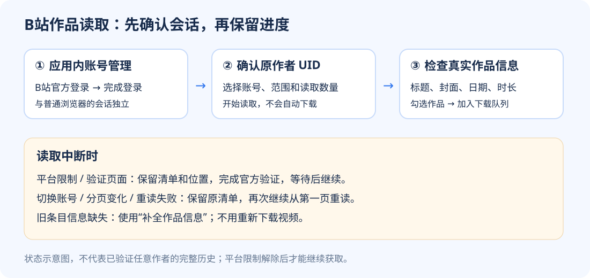

1. 先在窗口底部确认版本是 **0.4.3**；仅更新 GitHub 源码不等于本机程序已升级。
2. 普通浏览器能播放，不代表本应用已有同一个登录会话。在“账号管理”添加 B站账号，打开官方登录页，登录后回到应用点击“完成登录”，并选择该账号。账号会话仅保存在本机。
3. 回到“博主批量下载”，确认作者 UID，再点击“确认博主并读取作品”。切换账号后的继续读取会重新从第一页读取，避免拼接两种访问范围。
4. 平台限制、HTML 验证页面、重复页或数量变化不会被当成空的完整清单。旧结果保留；等待平台允许后继续，必要时重新读取。重新读取失败也可以继续尝试。
5. 如果重新识别后读取失败且清单为空，但同一作者、同一账号范围还保留旧记录，可点击“恢复上次清单”。恢复的历史结果会明确标注，不表示本次新读取成功；旧原记录保留，继续读取会从第一页重新开始。
6. 旧清单中的信息缺失可用“补全作品信息”单独修复；不完整响应不会清空原有封面、时长或日期。

客户端请求使用源站级来源地址。博主读取会先检查应用内登录会话，使用选中账号的会话及代理路径。此修复不会保证平台风控、验证码或登录限制解除。若仍显示平台限制，请检查应用内登录状态，不要连续重试。

## 0.4.3：先登录，再执行 B站博主读取

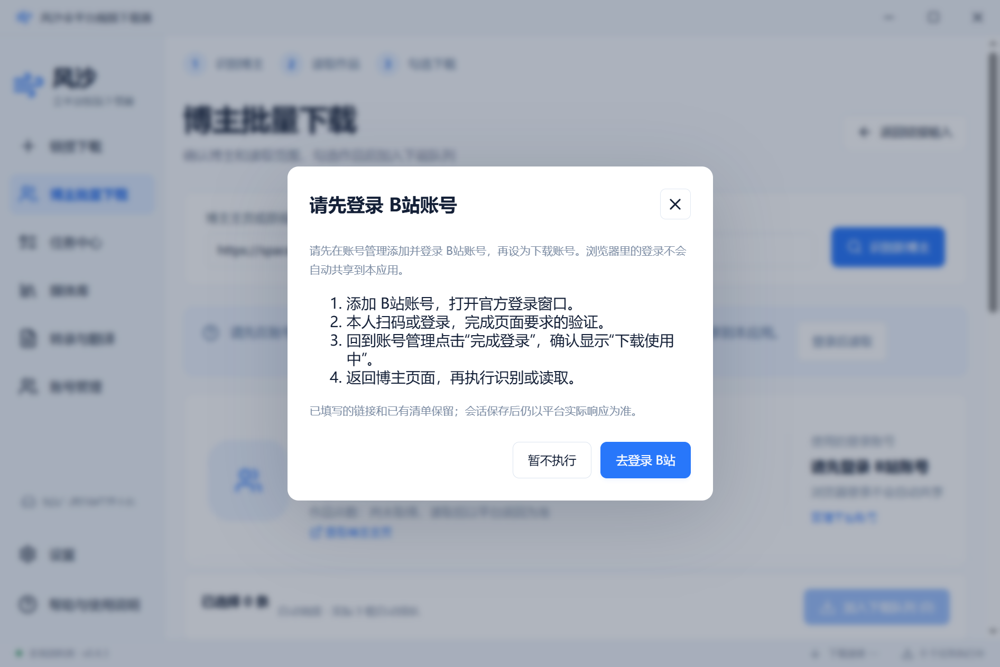

图为隔离数据的真实界面，用于展示提示步骤，不代表真实账号或全量作品读取成功。

- 未添加 B站账号、未点击“完成登录”或会话已过期：执行识别、读取、继续或补全前弹出提示；可以“暂不执行”或“去登录 B站”。不会先发送访客请求再报平台限制。
- 选择“去登录 B站”后进入该平台账号管理。添加账号 → 官方窗口扫码/登录 → 返回应用点“完成登录” → 确认“下载使用中”。只有访客页面资料不算完成登录。
- 从提示进入账号管理后，可点击“返回博主读取”；已填写链接和已有清单保留，需要本人再次点击执行，不会自动下载。
- 登录检查同样在后台执行；界面状态暂未刷新、CLI调用或预检期间退出/切换账号，都不会绕过检查。历史清单查看与恢复不用重新获取平台资料。
- 保存会话后仍可能遇到平台限制或验证；登录信息的存在不等于平台一定批准请求。单条公开视频识别/下载、其他平台既有流程保持原方式。

## 视频号与代理共存（0.6.5）

使用 Clash Verge 规则模式时，不用关闭系统代理、内核或代理守卫。搜索与识别会自动准备专用分流。请先在电脑微信内登录并打开视频号窗口；如 Windows 提示本工具证书信任，请核对名称后确认。详细操作、恢复方式和真实测试范围见 [代理共存说明](网络代理共存方案.md)。
