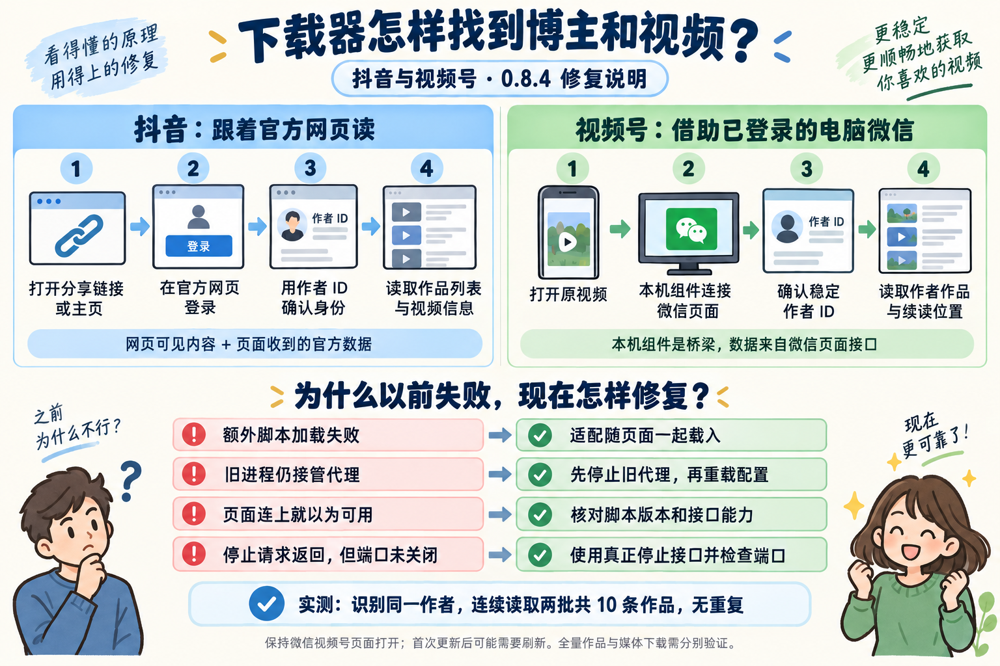

# 平台取数原理与视频号修复 · 0.8.4

> 后续纠正：用户在 0.8.4 安装界面仍复现失败。此文保留当时验证范围；完整故障分层和验收缺口见 [0.8.5 复盘](视频号反复失败原因复盘-0.8.5.md)。不能用本页后台读取成功推断安装界面的完整链路已经通过。

这份说明对应 2026-10-14 验证的 0.8.4 源码与 Windows 安装包。各平台采用各自的取数方式；“识别博主”“读取作品清单”和“下载视频文件”是三个分别验证的环节。

图中的版本/能力检查是延续的可靠性措施；0.8.4 的主要新增修改是适配内联载入、重载前真正停止旧代理，以及退出恢复的停止与等待逻辑。图示为概括，下面的文字说明是精确边界。

## 先理解三个编号

- **作者 ID**像身份证号，负责确定“是哪一个博主”。昵称和头像可以重名或更改，不能代替它。
- **作品 ID**像图书编号，负责确定“是哪一条视频”。标题相同也可能是不同作品。
- **续读位置**像书签，负责确定“下一批从哪里读”。保留书签和本批尚未展示的作品，才能继续读取并减少重复。

典型流程是：原视频或作者主页 → 确认作者 ID → 读取其发布作品 → 核对作品归属和类型 → 根据数量、日期、关键词筛选 → 保存清单 → 选中的作品进入下载队列 → 获取实际媒体地址 → 下载并检查文件。

## 不同平台目前走什么路线

| 平台 | 如何确认博主 | 如何读取作品信息 | 关键依赖 |
|---|---|---|---|
| YouTube | 频道链接、handle 或原视频返回的稳定频道 ID | yt-dlp 提取上传播放列表及视频信息，分批读取 | 下载引擎、网络；部分内容需要对应账号会话 |
| B站 | 主页 UID 或原视频返回的作者 UID | 专用 B站客户端读取签名后的上传作品接口，按实际页码读取；媒体解析使用下载引擎 | 登录/验证状态、当前 WBI 签名资料和平台响应 |
| 抖音 | 官方主页链接中的作者 ID，或原视频数据中的 `sec_uid` | 内置浏览器读取“作品”区域，并观察该页面实际收到的详情/作品列表响应 | 官方页面正常加载、对应浏览器登录会话 |
| 小红书 | 官方主页 ID，或原笔记页面的作者主页链接 | 内置浏览器读取“发布笔记”区域，只接收带视频标志的条目 | 登录/验证、页面结构；当前仍为实验接入 |
| 视频号博主批量 | 原视频返回的稳定 `username`，或带 `username` 的作者主页链接经接口核对 | 本机采集组件把详情/作者列表请求交给已登录的电脑微信页面，返回作品及分页标记 | 电脑微信视频号页面、本机组件、正确适配与临时连接 |

以上是当前项目的实现，不表示这些接口都是面向第三方开发者承诺稳定的公开 API。页面结构、登录校验和站点内部接口的变化都会影响适配。

## 抖音：像打开官网后整理“作品”栏

### 1. 先定位原视频或作者主页

分享文案中的抖音链接会被整理为官方视频或主页地址。短链接最多跟随 6 次跳转，并使用所选账号的浏览器会话；如果短链接跳回首页，程序明确提示重新复制，不把首页当成原视频。

### 2. 让官网完成正常加载

应用打开独立的 Electron 浏览器窗口，使用账号管理中选定的会话。抖音自身负责加载页面、执行页面脚本、携带该会话完成请求。需要登录或验证时，由用户在官方窗口完成。

程序一方面读取页面已经显示的作者资料和作品卡片；另一方面通过 Electron 的浏览器调试接口观察该页面收到的网络响应。观察范围限定在官方域名下的两类响应：

- `/aweme/v1/web/aweme/detail/`：单条作品详情。
- `/aweme/v1/web/aweme/post/`：作者发布作品列表。

这里是在读官方页面实际收到的数据。当前抖音路径没有另行建立一个自行伪造签名、盲目调用作品列表接口的取数流程。

### 3. 用编号确认身份和作品归属

原视频的 `aweme_id` 确认作品，作者 `sec_uid` 确认博主。详情响应必须匹配所请求的作品，作者列表响应必须匹配所请求的作者。若官方窗口被切换到其他博主或离开原视频，程序会停止，避免混入其他人的视频。

### 4. 滚动作品栏，取得更多条目

程序从“发布作品”区域读取链接、标题、封面，再用页面响应补充发布时间、时长、作者和播放地址。滚动页面让抖音自己加载下一批，按作品编号去重，保留已读取清单。

看见卡片并不等于一定可下载。抖音图文、私密、付费/受限制内容，以及没有实际视频地址的条目不能直接当作可下载视频。只在取得末页信号后，程序才可把当前列表标记为完整。

### 5. 下载时取得媒体地址

下载引擎再次取得所选原视频的信息，使用实际返回的播放地址及对应请求信息下载。普通视频下载主要由 yt-dlp 完成，FFmpeg 处理需要的音视频合并，完成后再做文件检查。

通俗比喻：**浏览器去官网拿到当前能看到的“目录和说明书”，下载引擎再按地址搬回视频文件。**

## 视频号：在电脑微信和下载器之间搭一座本机桥

### 1. 分享链接本身通常不够完成作者批量读取

视频号有两条相关路径，不能混为一谈。

- **单条公开分享视频**：已有专用解析路径，使用所选会话调用腾讯元宝的分享解析，再读取微信预览详情，取得媒体地址。这条路径能成功，不自动证明作者作品列表可读。
- **博主批量作品**：需要稳定作者 ID 和作者列表接口，主要依赖本机采集组件与电脑微信页面。没有可用会话或使用采集作品链接时，单条详情也可能走这条连接。

### 2. 本机组件负责桥接

内置 `wx_channels_download v260907` 是独立进程。下载器向本机 `127.0.0.1:2022` 发送请求；代理监听在 `127.0.0.1:2023`。组件在视频号页面载入时加入上游桥接脚本和本工具适配，页面通过 WebSocket 与本机组件相连。

HTTPS 页面使用本工具专用的本机证书进行临时连接。支持的 Clash 共存模式通过本机控制接口临时分流相关微信请求；其他自动连接路径临时切换系统代理。任务结束恢复分流/代理与本次添加的临时信任，再停止采集代理。已有账号登录仍在原官方环境中完成。

通俗比喻：**微信保留登录和访问现场，本机组件是传话的桥，下载器拿到的是微信页面接口实际返回的结果。**

### 3. 先证明原视频属于谁

详情请求使用原视频的分享标识或作品 ID。适配找到微信页面中实际可用的详情函数 `finderGetCommentDetail`，取得原作品和作者 `username`，并核对已有作者资料。程序不会因为搜索到相同昵称就把它当作同一个人。

直接使用带 `username` 的作者主页链接时，也要读取作者接口并核对返回的身份。

### 4. 按作者 ID 读取发布作品

本机 `/api/channels/contact/feed/list` 请求最终交给页面中的 `finderUserPage` 执行。程序使用作者 `username`、`lastBuffer` 等分页信息，读取作品 ID、标题、封面、时长和发布时间。

程序核对作者归属，过滤非视频条目，保留分页标记和本批尚未展示的记录。下一次继续时，先消耗这些已取得记录，再请求远端下一页。遇到错误会保留清单；接口错误、缺少分页状态或没有新书签，不被当作“已经读完”。大整数作品 ID 按字符串保留，避免 JavaScript 数字精度导致识别错视频。

### 5. 媒体下载另走下载处理

读取清单后，还要按所选作品取得实际媒体地址，并再次核对作品和作者。视频号专用 worker 使用微信返回的媒体处理参数下载、处理视频头并进行文件校验。这一步独立于作者列表读取。

## 为什么视频号这次反复失败

以下是本次截图、活动源码和实机进程能确认的问题链。不能据此断言以前每一次失败都有完全相同的原因。

### 第一层：新版“翻译器”没有成功进入页面

旧部署使用 `inject.globalScript`，让页面额外请求 `__assets/user/fengsha-content-d942281b07fd.js`。截图显示该资源加载失败。适配不运行时，页面仍用上游原始处理器，直接调用 `WXU.API2.finderSearch`，继而出现“不是函数”的错误。

此前已经实现了“按函数能力寻找接口”，能从实际模块中找回搜索、详情和作者列表函数；但脚本没载入，这段逻辑就没有机会执行。反复登录或刷新不一定能消除外部资源加载失败。

**0.8.4 改为 `inject.contentScript`：组件从本机文件读取适配，直接写入拦截后的 HTML。** 页面和适配一起到达，减少一次额外资源请求的失败点。同时关闭旧的外部适配入口。

上游把空的 `globalScript` 解析成工作目录，不能用空字符串可靠禁用。程序使用自己保留的不存在路径禁用它；该路径若已被占用，就停止处理而不覆盖文件。

### 第二层：新版控制台和旧代理曾经分属不同进程

实机发现 API 端口 2022 与代理端口 2023 由不同的组件进程占用。相当于“前台已经换新，实际接管页面的后台还在用旧版”。只改配置或刷新页面，可能仍拿到旧脚本。

本次经用户授权，仅结束核对过路径的 5 个残留采集进程。**日常修复逻辑改为重载配置前先停止采集代理，并等待服务状态为 stopped、端口不再监听，再重载。**程序不自动强杀其他微信或采集工具。

### 第三层：“禁用并重启”实际上仍会启动代理

固定上游 v260907 对 `proxy/config` 的 `restart:true` 总是执行停止再启动，即便同时设置 `proxy.enabled:false`。旧退出代码把这个请求当作停止，因此不能保证任务结束后端口释放。

**0.8.4 使用明确的 `/api/service/stop`，同时以 `restart:false` 保存禁用配置，并检查实际停止状态。** 主流程、手动恢复和后台恢复守护使用对应的停止行为；恢复失败时保留记录，允许再试。

### 第四层：停止状态检查还查询 Windows 证书库

移除临时证书后，状态接口可能接近或超过原来的 2.5 秒等待时间。端口已经关闭也可能被误报为恢复超时。**改用已有的 15 秒接口等待时间**，最终真实读取与恢复正常结束。

脚本指纹、适配版本和当前任务所需能力的核对继续保留。这些检查以前已有；本次修复确保正确适配能载入，并用实测确认这些检查真正通过。

## 0.8.4 修改文件

| 文件 | 修改内容 |
|---|---|
| `electron/collector-connection.js` | 内联部署；禁用外部适配入口；重载前停止；明确停止并等待端口释放；恢复失败保留状态；状态等待使用正常接口上限 |
| `electron/collector-system.ps1` | 后台恢复守护改为明确停止，不再“禁用后重启” |
| `bin/collector/collector-system.ps1` | 随包恢复脚本同步，构建时由源码生成 |
| `tests/collector-inline.test.js` | 外部资源失效、内联执行、停止端口与恢复失败重试的定向验证 |
| `tests/collector-connection.test.js` | 更新内联配置与连接恢复的测试场景 |
| `tests/collector-system-state.test.js` | 验证生产 PowerShell 恢复函数发出真正的停止请求 |
| `package.json`、`cli/version.json` | 版本统一为 0.8.4 |
| README 与安装/验收/本说明 | 修改说明、证据边界、版本保存入口及使用注意事项 |

本次没有更新抖音取数代码，也没有更换固定的采集组件二进制。按能力寻找微信模块、作者核验、大整数处理和断点续读是延续的已有实现。

## 实际验证到了哪里

- 完整串行测试 740 项通过；最后恢复逻辑调整后，相关定向测试 48 项通过。
- 真实内置采集组件复现旧停止方法的问题，新停止方法连续两轮启停通过。
- 真实识别“戏里戏外说2026”，连续 8 次无缓存探测均返回适配 v4、指纹 `d942281b07fd` 及当前能力。
- 连续读取两批各 5 条，共 10 条真实作品，作品 ID 无重复；第二批使用第一批剩余记录。**这验证了真实作者列表和本地续读，不等于验证了第二次远端翻页、全部历史作品或全部媒体下载。**
- 最终安装退出码 0，136 个应用载荷文件及采集资源与当前内容逐字节一致；两次启动与博主页面打开通过，最后通过原桌面快捷方式启动。
- 原有业务/配置记录及媒体文件保持一致；Clash 规则已恢复、2023 不再监听。代理地址、启用值及 PAC 保持；`ProxyOverride` 有独立变化，未宣称所有系统设置逐字节一致。

此次没有重新做抖音的实时全流程测试；抖音部分来自当前源码核对。

## 使用注意事项

1. 用 0.8.4 原快捷方式启动，进入“博主批量下载”。保留的旧失败记录可以点击“重新识别”；它不是新版重新执行后的结果。
2. 视频号批量读取时保持电脑微信的视频号页面打开。首次升级后，已有页面可能仍运行旧脚本，需要刷新或重新进入一次，随后程序会核对适配。
3. 优先提供原视频或准确作者主页链接；昵称用于显示，身份由作者 ID 确认。
4. “已读取 10 条”表示当前拿到的条数，不表示该作者只有 10 条。只有明确末页信号才表示当前可访问列表已完整。
5. 识别作者、读取清单、下载文件分别看结果。媒体地址、权限和登录状态可能在下载时改变。
6. 出现恢复提示时使用“恢复原网络”；有进行中的读取/下载应先停止。不把独立微信、Clash 或其他采集工具强行关闭。
7. 平台登录或验证码在官方窗口完成。已有清单和续读位置保留；平台限制不能被解释为空列表或末页。

## 怎样保留这版

GitHub 保留 `v0.8.4` 标签及 Release；源码、测试、依赖锁文件、说明图和本说明进入版本历史。安装包、说明文档压缩包和 `SHA256SUMS.txt` 作为 Release 附件保存，安装包不写入 Git 源码历史。

已经验证的 Windows 安装包名为 `FengshaVideoDownloader-0.8.4-setup.exe`，大小 **912,694,418 字节**，SHA-256：

`C7764F4A0C6AF9F1D52FD593141CD378DA2D6891AE5D64630E0B618017EB1CBF`

标签便于找回代码，Release 附件便于找回已验证安装包，校验值确认下载的文件就是这份。后续版本使用新标签，不移动或覆盖这个标签与安装包。原有用户数据不上传 GitHub，也不随安装包打包。

源码入口：[`creators.js`](../electron/creators.js)、[`creator-browser.js`](../electron/creator-browser.js)、[`douyin.js`](../electron/douyin.js)、[`wechat-creators.js`](../electron/wechat-creators.js)、[`collector-content.js`](../electron/collector-content.js)、[`collector-connection.js`](../electron/collector-connection.js)、[`wechat.js`](../electron/wechat.js)、[`engine.js`](../electron/engine.js)、[`bilibili.js`](../electron/bilibili.js)。详细验收过程见 [0.8.4 验收记录](验收-0.8.4.md)。

说明图由本次内置生图功能生成，最终提示词保存在 [生图提示词](生图提示词-0.8.4.txt)。
