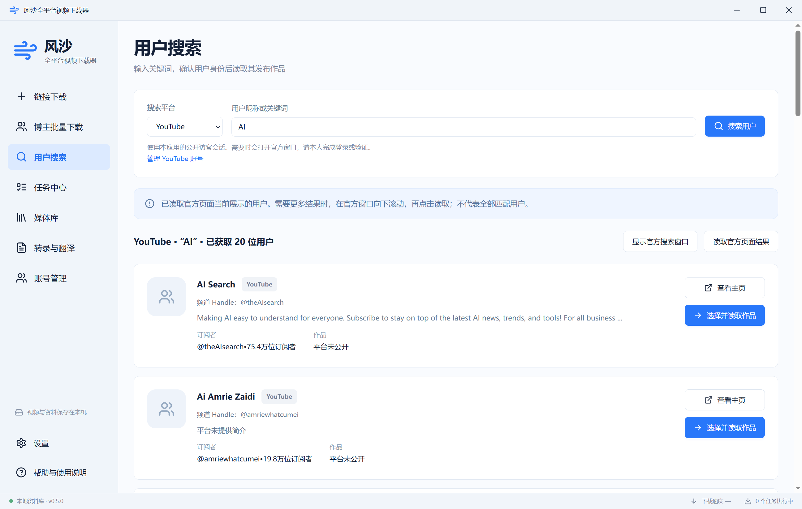

# 关键词搜索用户（0.5.1）

左侧新增 **用户搜索**，接入视频号、抖音、小红书、B站、YouTube。一次选择一个平台，搜索公开用户资料，核对候选用户后再进入博主作品读取。



上图是本机用公开访客会话搜索 `AI` 的真实 YouTube 结果。其他平台需要各自登录或连接条件；这张截图不代表五个平台都已完成真实账号验收。

## 使用步骤

1. 打开 **用户搜索**，选择平台，输入用户昵称或关键词，点击 **搜索用户**。
2. 核对昵称、头像、简介及平台用户 ID。平台返回粉丝或作品数据时会显示；没返回时标为“平台未公开”，不把未知数当成 0。
3. 遇到登录或验证码，在弹出的**官方窗口**本人完成。返回风沙点击 **读取官方页面结果**。账号在应用内管理；视频号搜索使用微信客户端中的登录，不等同于应用里的网页登录。
4. 同名账号通过不同用户 ID 区分。点击 **查看主页** 确认，再点 **选择并读取作品**，进入原来的博主批量下载页面。
5. 在博主页面确认读取范围，勾选作品后加入下载队列。搜索及选择用户不会自动下载。

## 五个平台的读取方式

| 平台 | 条件 | 更多结果 | 当前验收边界 |
| --- | --- | --- | --- |
| 视频号 | 本机采集服务已连接，已登录微信且保持视频号页面打开；服务不可达时先进入“视频号连接设置” | 服务提供分页位置时“加载更多用户”；旧服务不提供位置时只报告本次结果 | 接口及分页映射已在隔离测试验证，当前真实微信连接未验收 |
| B站 | 先在账号管理完成 B站登录 | “加载更多用户”，按平台页码去重 | 登录前检查和模拟分页已验证；当前未保存真实 B站登录，登录后搜索未验收 |
| 抖音 | 官方用户搜索页；需要时本人登录/验证 | 在官方页滚动，再点“读取官方页面结果” | 本机公开访问遇到验证/未返回可识别卡片；正常登录后的真实搜索未验收 |
| 小红书 | 官方用户搜索页；需要时本人登录/验证 | 在官方页滚动，再点“读取官方页面结果” | 本机公开网络触发风险，Electron 官方页未能连接；真实搜索未验收 |
| YouTube | 官方频道搜索页，网络可访问 YouTube | 在官方页滚动，再点“读取官方页面结果” | 原生桌面窗口实测 `AI` 返回 20 个公开频道；读取的是当前展示结果 |

YouTube 返回 Handle 时显示“频道 Handle”，不伪装成 UC 频道 ID。抖音展示 sec_uid，视频号使用平台 finder username，小红书使用主页 ID。不会用昵称拼出假主页，也不会从视频推荐里提取作者作为用户搜索结果。

## 错误和结果保留

- **未登录 B站**：先进入账号管理，本人登录后点击“完成登录”，再返回搜索。
- **平台要求验证**：保留已获得的用户，官方窗口完成验证后再读取；未取得卡片不报告“没有匹配用户”。
- **B站限制请求**：停止连续提交，完成官方验证并至少等待一分钟。应用冷却只能减少重复请求，不能保证平台解除限制。
- **官方页无法连接**：检查网络与安全连接；程序不自动关闭安全验证、不切换代理规避限制。
- **搜索时切换账号**：重新搜索，避免混合两个账号可见的结果。
- **继续读取没有新用户**：保留已有结果和位置，稍后继续，不把重复页当成末页。

一次搜索最多保留 500 个用户。切换应用内页面保留关键词和当前结果；关闭应用后需要重新搜索。搜索 ID 只在当前本机进程有效，不写入用户库；已经选定的博主和读取清单沿用原有持久化方式。

## Agent / CLI

安装版调用 `fengsha-cli.cmd`，也可用源码命令：

```powershell
node cli/fengsha.mjs search 'AI 工具' --platform YouTube
node cli/fengsha.mjs search '摄影' --platform B站
node cli/fengsha.mjs search '电梯' --platform 视频号
node cli/fengsha.mjs search 'AI' --platform 抖音
node cli/fengsha.mjs search 'AI' --platform 小红书
```

输出的 `data.users` 包括 `platform`、`id`、`idKind`、`name`、`url`、`avatar`、`description`、`followers`、`videos` 和平台原文计数字段；没有值的精确计数为 `null`。数字是 0 与平台未返回有区别。

继续当前搜索：`search --record 搜索ID --continue`。浏览器方式会打开可见官方窗口，**需要人工验证时并非无人值守**；窗口保持打开期间后台不会按普通空闲超时退出。`status=needs-action` 返回部分结果及退出码 4，Agent 应把 `message` 展示给用户，而不是自动重复调用。

确认用户后，将 `data.users` 中选定用户的 `url` 传给原来的 `creator` 命令；再明确选择作品执行 `download`。完整命令和下载文件读取方式见 [CLI说明](CLI使用说明.md)。

## 参考与限制

视频号接口来自内置采集组件的 [官方源码](https://github.com/ltaoo/wx_channels_download)，路由 `/api/channels/contact/search`，参数 `keyword`、`next_marker`；不会把好友关注人数当成粉丝数。其他平台使用各自官方搜索响应或官方窗口中的用户卡片。

用户提供的微信短链接演示在当前环境无法读取，本版本按已确认的“关键词搜索用户、五个平台”实现，未声称逐项复刻演示视频。平台接口和页面结构变化仍可能影响读取，登录和安全验证由本人完成。

## 视频号与代理共存（0.5.1）

使用 Clash Verge 规则模式时，不用关闭系统代理、内核或代理守卫。搜索与识别会自动准备专用分流。请先在电脑微信内登录并打开视频号窗口；如 Windows 提示本工具证书信任，请核对名称后确认。详细操作、恢复方式和真实测试范围见 [代理共存说明](网络代理共存方案.md)。
