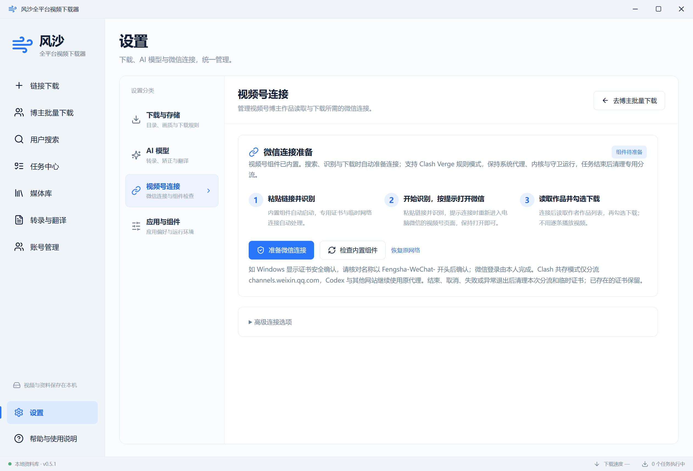
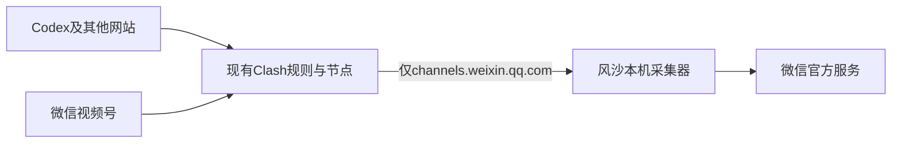

# 视频号与 Clash Verge 共存

0.5.1 为视频号搜索、作品识别和下载自动建立专用分流。**不用退出 Clash，不用关闭系统代理或代理守卫**；Codex 及其他网站继续使用原节点。

## 怎么使用

1. 保持 Clash **规则模式**，系统代理和内核运行；代理守卫可以保持开启。
2. 打开电脑微信并完成登录，再打开微信客户端里的视频号窗口。
3. 在下载器“用户搜索”选择视频号，输入关键词；或粘贴视频号链接识别。应用自动准备采集器和分流。
4. 如 Windows 出现证书安全确认，核对名称以 **Fengsha-WeChat-** 开头后确认。这是 Windows 的信任流程，应用不关闭安全检查。
5. 提示等待连接时，关闭并重新进入微信的视频号窗口。连接后继续搜索或读取作品。

只打开浏览器中的视频分享页，不等于微信客户端已登录并接入。微信登录、手机确认或官方验证仍需要本人完成。

## 应用具体改变什么

- 只在运行中的 Mihomo 配置中临时增加一个本机 HTTP 代理、一组自动回退策略和一条精确域名规则。
- 不写入订阅文件，不修改 Windows 系统代理，不关闭守卫，不安装网络驱动；保留已有节点选择。
- 本机控制接口鉴权只用于本机请求，不返回到页面、CLI 或公开日志，不进入 GitHub。
- 采集子进程不继承 Codex 的代理环境，避免请求经过 Clash 再返回采集器的循环；Codex 的环境保持原样。
- 本次新增的专用证书仅进入当前 Windows 用户的证书库；任务结束后移除。原本已有的证书保留。
- 结束、取消或异常退出后，独立恢复守护清理分流并停止采集代理。若用户同时修改了规则，应用保留新配置并报告恢复未完成；在 Clash 重载当前配置可以清除临时分流。

示例 [微信分流片段](微信分流-审阅片段.yaml) 不是完整配置，无需用户复制，不能替换订阅。原理依据 Mihomo 官方的 [HTTP 代理](https://wiki.metacubex.one/config/proxies/http/)、[精确规则](https://wiki.metacubex.one/config/rules/)、[自动回退](https://wiki.metacubex.one/config/proxy-groups/fallback/) 和 [配置 API](https://wiki.metacubex.one/api/)。

## 适用范围和真实验证

本机使用 Clash Verge 2.3.1、Mihomo v1.19.10、规则模式、单一本机系统代理。真实测试通过：视频号 HTTPS 证书链、页面注入、同时访问 GitHub HTTP 200、原节点选择保留、Windows 代理值不变、正常结束清理。异常退出恢复测试单独记录在本版验收报告。

这些测试证明代理共存链路；**不等于微信真实关键词结果已验收**。当前微信停在登录界面，仍需登录与 Windows 证书确认后测试关键词“减肥”。其他代理软件、Clash 全局/直连模式、TUN、不同微信版本尚未完成共存验收；遇到不能确认的配置时不强行覆盖。

未使用 Clash 时沿用原有临时系统代理方式；复杂 PAC 或不受支持的代理设置会明确提示。官方登录、访问权限和平台限制不会因为分流而解除。
