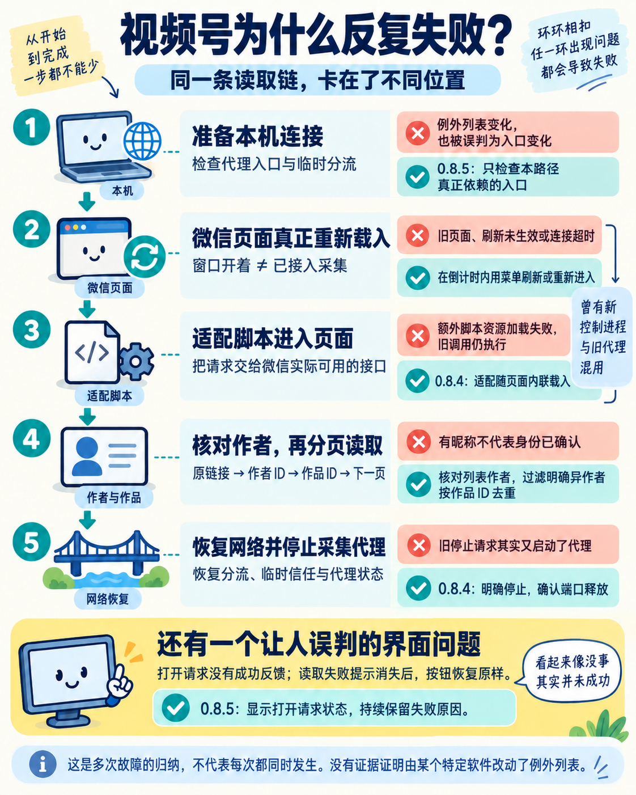
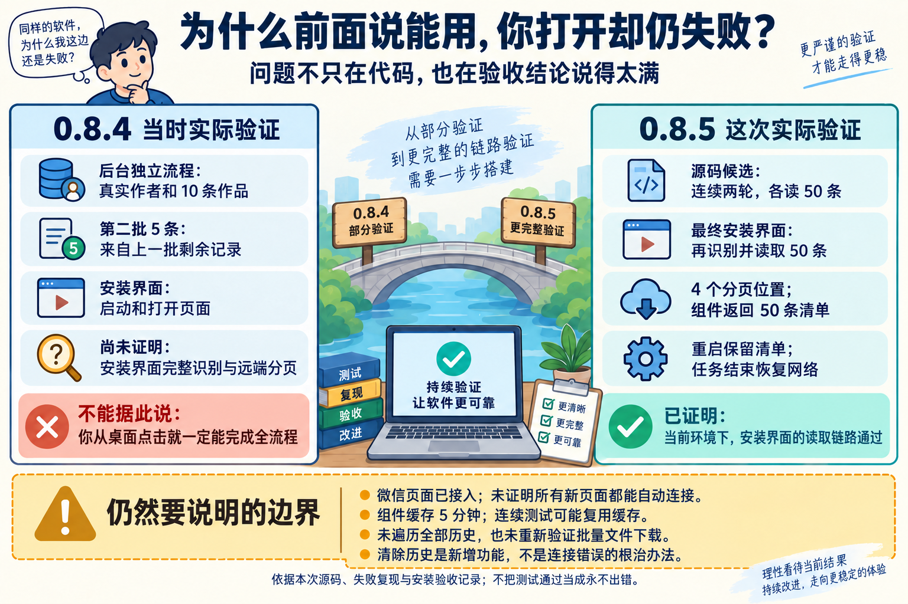

# 视频号为什么反复失败：故障链、验收缺口与 0.8.5 的真实边界

这次重新核对后的结论是：**不是同一个问题被反复修好又失效，而是几处独立缺陷出现在一条有状态的连接链上；前面又把局部验证的成功说得过于完整。**

你的反馈是成立的。之前说“可以了”，实际证据只能证明当时准备好的微信页面和后台读取流程能工作，不能保证你随后从桌面安装版开始操作也能完成整条流程。以下依据截图、实际源码、失败复现、真实内置组件和安装界面记录重写；没有证据的原因不再写成事实。

## 先弄清楚：这件事不是把一个网页链接交给下载器就结束

视频号的“博主批量读取”依赖电脑微信里真正运行着的网页环境。下载器先建立本机连接，让微信页面载入桥接和适配代码；页面接入本机服务后，下载器才能请求原作品详情、核对作者 ID，再请求该作者的作品列表。

可以把它理解为：**下载器发任务 → 本机组件传话 → 微信页面用自己的接口取数 → 返回作者与作品 → 下载器检查并保存。**

这里有三个不同的“开着”：

- 电脑微信进程开着：只代表微信在运行。
- 视频号画面开着：只代表屏幕里有内容，可能是早先载入的页面。
- 页面已经接入采集：页面中的桥接代码连到了本机服务，而且本次需要的详情、作者列表接口可用。只有这一层满足，才能开始读作品。

所以“窗口开着”“能看到昵称”“本机服务在运行”“已经拿到作者 ID”“读到了作品清单”“下载出了视频文件”都不能互相替代。

## 已经确认的故障，分别卡在哪一层

| 故障 | 实际证据与影响 | 对应修复 | 结论边界 |
|---|---|---|---|
| 适配代码没有成功载入 | 截图出现额外脚本资源加载失败，同时旧处理器调用 `WXU.API2.finderSearch` 报“不是函数”；新适配没有执行机会 | 0.8.4 把适配直接写进被拦截的 HTML，并关闭旧外部脚本入口 | 资源为何在那次加载失败，没有进一步锁定；不能直接归咎网络、杀毒软件或微信升级 |
| API 与采集代理由不同进程持有 | 实机见到 2022、2023 分属不同组件进程，单独重载配置不能证明实际代理已换到本轮状态 | 0.8.4 重载前明确停止代理，等停止状态和端口释放，再重载；当时经授权清理了已核对路径的残留进程 | 不同 PID 证明运行状态不统一；仅凭 PID 不能断言两个可执行文件版本不同 |
| “停止”请求实际上又启动了代理 | 固定上游组件在 `restart:true` 时执行停后再启；真实组件测试中旧停止方法返回后端口仍监听 | 0.8.4 改用明确停止接口，禁用配置时不再触发重启 | 这是生命周期缺陷，能造成残留和后续混用；不是每次作者识别失败的唯一解释 |
| 微信页面没有在本轮接入 | 安装版实际进入等待后超时；当时能看见视频号画面，但页面在线状态仍为否。按 F5 后也未观测到连接建立 | 0.8.5 指引改为在倒计时内用微信视频号菜单刷新，或关闭该页面再进入；打开请求和检测结果明确反馈 | 没有证明 F5 在所有微信版本都无效；也没有实现对所有新页面都可靠的自动接入 |
| 不涉及本路径写入的例外列表变化，被当成入口变化 | 真实失败定位到代理基线检查；回归用例复现：入口不变、只有 `ProxyOverride` 变化时，旧逻辑仍拒绝继续 | 0.8.5 在 routed 分流模式只核对代理启用值、服务器和 PAC；不改写例外列表。普通系统代理模式仍核对四项 | 已确认字段发生变化，**未确认是谁改的**；此前“外部软件刷新”说得过实，不能点名归责 Clash 或微信 |
| 点击与失败的反馈不完整 | “打开微信”请求返回后没有明确反馈；读取失败后只有短暂通知，博主页没有持续保留原因。界面回归先失败、修复后通过 | 0.8.5 显示“已发送打开请求”，并在博主页持续显示读取失败原因 | 这解释“看起来没反应”，但仅改善提示不等于底层连接已经恢复 |
| 恢复状态检查等待太短 | 上游状态查询还涉及 Windows 证书库；出现端口已经关闭、状态查询却超时的情况 | 0.8.4 使用已有的 15 秒接口等待时间 | 这是结束阶段的误报问题，不能直接解释最初脚本为何没载入 |

### 为什么错误会从“函数不存在”变成“等待连接超时”？

因为程序后来走到了不同阶段。

最初，额外脚本没载入，页面沿用不适合当前实际接口对象的旧调用，于是在页面本地调用阶段报“不是函数”。这时尚不能从错误判断是账号权限或远端请求被拒。

改成内联以后，脚本部署问题有了修复，但**已经打开的旧页面不会因为磁盘文件换了就自动执行新代码**。它需要在临时连接生效期间真正重新载入。仅把窗口放到前台、切换正在播放的视频，或者发送一个唤起微信的请求，都不能证明发生了这次重新载入。如果页面还没接入，程序就停在“等待连接”，不是又回到了同一个函数错误。

等待也有期限。当前默认约 120 秒，倒计时从本轮连接准备完成后开始。页面重新载入和桥接上线都需要时间；如果上一轮已经超时恢复网络，稍后才完成刷新，上一轮不会因此自动变成成功。需要重新开始识别或读取，在新一轮连接提示出现后完成页面操作。0.8.5 改进了说明，**没有把超时时间延长当成根治方案**。

### 为什么已经连上了，有时又会在开始前失败？

旧代码把四个系统代理字段全部比较，其中 `ProxyOverride` 是“哪些地址不走系统代理”的例外列表。此次专用分流路径不负责修改这个列表，却因它变化而终止任务。用户就会遇到“微信都开了，还是没读出来”。

修复只缩小了这条路径的检查范围：代理是否开启、代理服务器、PAC 地址仍然要一致；普通系统代理切换路径仍检查例外列表。**不是忽略所有代理变化，也不是关闭安全保护或覆盖系统设置。**

我们没有捕获写入该字段的进程，所以只能确认“变化触发了不必要的拒绝”，不能确认“某软件导致了这次变化”。

### 为什么当时播放另一个视频，后来仍能识别原博主？

微信视频号窗口提供的是登录环境和接口运行现场。下载器的任务参数来自你粘贴的原链接：先用原作品标识取得作者 ID，再按这个 ID 读取作品，检查列表及条目返回的作者信息，过滤明确的异作者。窗口当前播放的视频不是本次作者的判定依据。

因此，保持一个能接入的官方页面有用，但不要求手动逐条播放目标博主的视频，也不能用当前画面的昵称替代作者核验。

## 前一次“已经可以了”，具体哪里说过头了

0.8.4 当时确实取得过真实作者和作品，不是假数据。但有两组验证被我合在了一起理解：

1. **独立后台流程**：在用户协助重新打开、刷新微信页面之后，核对作者，并读取两批各 5 条。第二批来自第一批已经取得但尚未展示的剩余记录，没有证明第二次远端翻页成功。
2. **安装版检查**：安装文件与构建内容一致，能启动、重启、打开“博主批量下载”页面，资料保留。但当时没有通过安装界面点击“识别 → 读取”完成同样的真实流程。

这两项分别成立，仍然缺少它们之间的整段：**从安装界面开始、进入连接等待、页面接入、作者识别、远端连续分页、恢复网络。**

另外，那次后台成功时页面已被准备好；你后来打开软件时，微信页面的接入状态可能不同。一个已经接通的会话能读数据，不能证明一个尚未注入桥接代码的新页面也会自动接通。前面的结论没有充分交代这个前提，这是我的验收和表达问题，不应归因于你没有按步骤操作。

本次排查中还出现过自动测试进程未继承正常 `APPDATA` 环境导致的检查失败。恢复正常启动环境后消失；这是测试启动方式的问题，没有作为产品根因，也没有为此修改用户系统配置。

## 又核对出一个重要边界：组件还有 5 分钟缓存

固定组件 v260907 的 `FetchChannelsFeedListOfContact` 先用“作者 ID + 分页标记”查内存缓存，命中就直接返回；未命中才向微信页面发送请求，结果缓存 5 分钟。应用自己的“确认博主并读取作品”会重置作品清单与书签，但不会清空这个组件缓存。

因此，验收记录里的 `usedCollectorCursors.length = 4` 证明处理了 4 个不同分页位置，按应用代码会向本机组件发出列表请求；**它不能单独证明 4 次请求都在那一刻重新到达微信官方服务器。** 连续两轮成功可能包含组件缓存复用。之前直接把这个计数命名为“远端分页次数”并据此表述，确实不够准确，本次纠正。

最后安装版测试距前两轮候选测试已超过 5 分钟，符合缓存过期条件；但当时没有单独记录每次缓存命中与页面调用，仍不把它写成已经逐次抓包证明的源站新请求。这不否定读到了真实清单，也不把连续读取说成所有外部步骤每轮都重新验证了。

另一个边界是作者核验：原链接作者身份已经确认；列表返回明确的其他作者会拒绝，条目返回明确的异作者会过滤。但条目缺失原始作者字段时，当前实现沿用所请求作者生成结果记录，未再对 50 条逐个取详情独立复核。因此结果中的“作者 ID 一致”不能等同于逐条做了独立原始身份取证。

## 0.8.5 现在真正证明了什么

| 检查 | 已有结果 | 不能外推成什么 |
|---|---|---|
| 完整自动测试 | 747/747 通过；针对代理例外变化、提示缺失的用例先复现失败，再通过 | 不能代替真实平台验证 |
| 源码候选实际界面 | 连续两轮识别“老头们的快乐生活”，每轮 50 条，4 个不同分页位置；每轮内作品 ID 不重复，结果记录的作者 ID 与请求作者一致 | 不是取得 100 个不同作品；两轮可重复读取同一批 |
| 最终安装版实际界面 | 再识别正确博主并读取 50 条，4 个不同分页位置；没有页面脚本错误 | 不是遍历博主全部历史，也不是批量媒体文件下载验收 |
| 重启与恢复 | 重启后清单仍有 50 条；任务状态回到 idle；分流规则与代理入口保持，采集代理停止 | 例外列表仍有独立变化，不能说所有系统字段逐字节一致 |
| 资料保护 | 原有 83 条受保护记录保留，账号正常验证时间允许更新；86 个媒体文件哈希一致 | 不是对电脑所有资料做了全盘审计 |
| 两个清除入口 | 独立测试账号和历史经界面清除后，重启未恢复；另一账号和资料保留 | 没有替用户清除真实历史、账号或文件 |

**当前的准确结论是：在此次微信页面已完成接入的环境中，0.8.5 最终安装界面的作者识别和向采集组件分页读取清单的链路通过了真实验证。**

尚未证明所有微信版本、所有新开页面、所有启动顺序都能自动连接。当前代码仍依赖官方页面实际加载和接口可用，必要时仍需在连接提示出现后刷新或重新进入页面。此次没有重新验证全部平台，也没有用列表读取成功代替媒体下载成功。

## “清除缓存”是不是这次的解决办法？

不是。清除博主历史与删除账号会话是后来按你的要求增加的独立功能：

- “清除博主历史”删除保存的输入来源、作者、作品清单和读取位置，不删除已下载视频和任务。
- “删除账号及会话”删除选中账号在本应用的记录和独立登录会话，不注销平台账号，也不退出电脑微信。

这些入口解决“不想保留本机历史”的需求；没有证据表明旧博主清单或账号缓存是上述脚本加载、代理检查、连接超时的根因。尤其删除本应用的平台账号不会重新注入电脑微信中的采集脚本。不能建议靠反复清空资料解决连接问题。

## 发布与证据

0.8.5 的程序修复、747 项测试和安装验收结果在这次说明更新前已经完成；本次更新以发布这些已验证内容、纠正说明和清理旧安装包为主，没有用一张说明图代替新的实测。

详细交付记录见 [0.8.5 验收记录](验收-0.8.5.md)。旧 [0.8.4 原理说明](平台取数原理与视频号修复-0.8.4.md) 保留历史版本事实；涉及后来失败与当前保证范围，以本复盘为准。GitHub 的 `v0.8.4` 标签和 Release 保留，不移动标签或覆盖旧安装附件；新版本使用 `v0.8.5`。

本机关键证据：`output/repair-084/component-lifecycle.json`、`live-result.json`、`installed-result.json`；`output/repair-085/installed-repro-084.txt`、`proxy-race-red.txt`、`proxy-race-green.txt`、`read-feedback-red.txt`、`candidate-result.json`、`installed-live-result.json`、`payload-check.json`、`data-check.json`。原始运行日志、账号资料和用户数据库不上传 GitHub。

两张图均使用内置 `image_gen` 生成并检查文字；项目内保存原图，提示词见 [生图提示词](生图提示词-0.8.5.txt)。图是故障层次的概括，逐项事实与未确认部分以本文说明为准。
