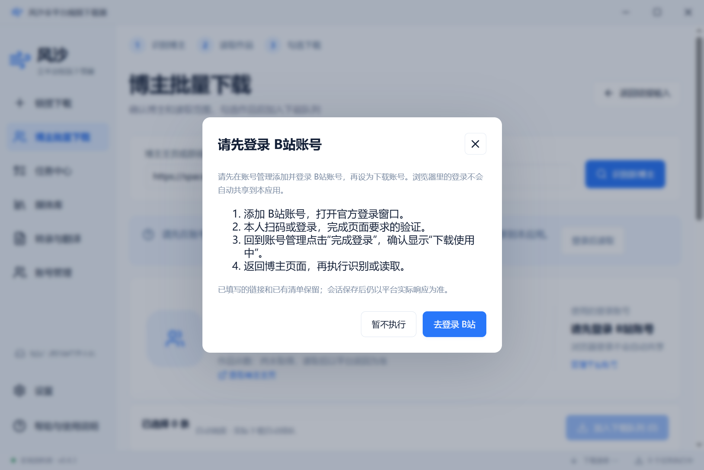

# 0.4.3 B站登录前置提醒

日期：2026-10-06。

## 本次行为

- B站博主识别、读取、继续读取、信息补全先检查选中的应用账号。未添加账号、未完成登录、已过期或缺少本机登录信息时，先显示“请先登录 B站账号”，不先向平台提交作品请求。
- 提示提供“暂不执行”和“去登录 B站”；进入账号管理后可“返回博主读取”，链接与已有清单保留，不自动开始下载。
- 前端、后台和CLI均执行检查。登录预检期间取消、退出或切换账号，也不会把旧检查结果用于新的账号请求。
- B站“完成登录”检查本应用会话中的登录信息；只有访客页面资料不算完成登录。恢复旧会话时，缺少登录信息的 B站账号会提示重新登录；不删除账号或历史资料。
- 单条公开视频识别与下载、历史清单查看和恢复、其他平台流程保持原方式。CLI未登录返回BILIBILI_LOGIN_REQUIRED、退出码1；历史记录只读仍可执行。

图为隔离测试数据的真实0.4.3界面，不包含用户账号、密码或会话。

## 验证范围

- 104项自动测试，包含无账号、未完成、过期、访客会话、预检期间取消/退出/切换及既有功能回归。
- 登录专项验证真实界面和本机会话保存流程：识别/重读/继续/补全均在请求前提醒，拒绝访客资料作为完成登录，登录入口指向 B站，返回保留链接和历史，已保存模拟会话可以执行，过期再次提示，CLI历史只读不受影响。
- 1080×720窗口中提示完整可见；页面错误为0。
- 列表专项及设置专项通过：55条模拟元数据分页、旧清单补全与恢复、CLI、图片恢复、四类设置、小窗口、模型模拟服务、重启保存。
- 登录和列表测试使用隔离的模拟会话及接口，不能据此声称真实 B站登录后的全量读取或平台风控已经解除。保存本机登录信息也不等于平台一定接受后续请求。

## 安装与发布

- 最终完整安装包：FengshaVideoDownloader-0.4.3-setup.exe，897806033字节，SHA256：`035d7af1186958a9fdceddd5a77d807215d9c3c3f1b458d5dfe477189bd234ab`。
- 实际打包程序在独立资料目录中通过登录提示验证，未使用测试模式或模拟平台响应。前端、原生后台与包内CLI均拒绝未登录博主请求；B站平台请求数0，进入账号管理及返回链接保留，原记录不变，页面错误0。结果：output/packaged-login-1791261863221/result.json。
- 包内 Node/CMD、四项下载组件、实际合成视频下载/检查、桌面复用及图文帮助通过；已下载文件经FFmpeg完整解码通过。结果：output/packaged-cli-1791261875508/result.json。
- 安装包2615个文件完整归档检查通过；提取的app.asar、CLI、CMD、登录提示图及NumPy模块与已测试程序逐字节一致。本地语音运行时实际导入numpy与faster_whisper通过，不代表真实音频转录已完成验收。
- 第一次压缩因生成目录中的NumPy模块被本机文件保护组件占用而失败；只对该生成文件以原内容重新写入，再从已测试程序生成最终安装包。最终安装包已独立核验；构建器在清理临时压缩文件时仍遇到EBUSY，不能记为构建退出码0。没有修改系统文件保护策略或删除用户资料。
- 桌面原应用当前仍有 B站账号处于“登录中”，尚未覆盖升级；已提示本人完成并保存登录，或明确允许关闭未完成的窗口。升级前将备份并核对原设置、账号、资料与会话，完成后的结果追加记录。
