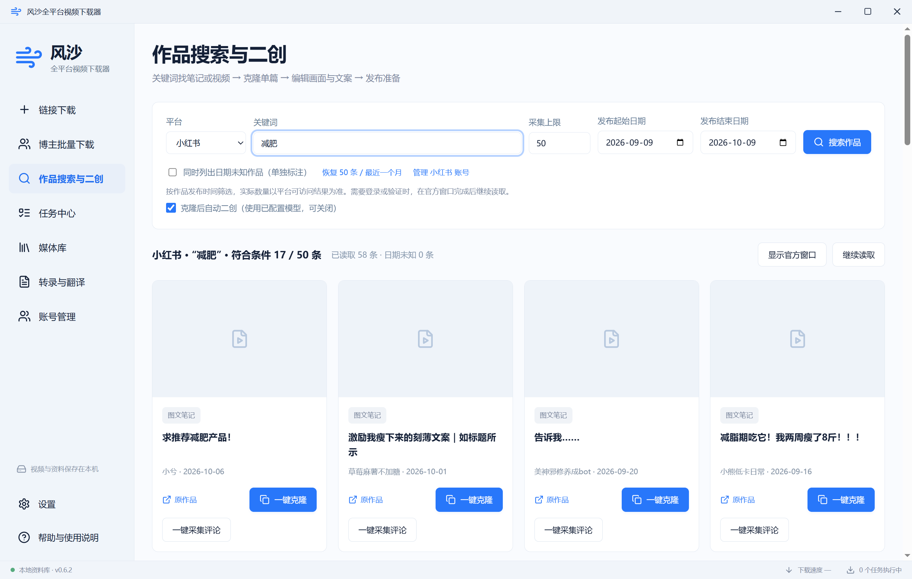

# 0.6.2 小红书搜索验收

日期：2026-10-09。

## 真实失败及原因

安装版 0.6.1 执行“小红书／减肥”稳定报 ERR_FAILED，0 条读取。实际跳转是 http://www.xiaohongshu.com/search_result/，被应用的 HTTPS 限制拦截。此前简单验证页面能打开不足以证明实际搜索可用。

还定位到：读取器不接受末尾斜线；选择了没有 xsec_token 的封面链接，详情返回 404；续读把已确认的日期、正文覆盖为空；官方图片是 HTTP WebP，地址过滤和 nativeImage 解码导致原图丢失。

## 修复

使用规范化搜索路径；拦截 HTTP 降级后只向同一官方站点重新发起 HTTPS，回归确认没有明文 HTTP 请求。优先保留带访问令牌的作品链接；不把令牌写入日志或发布材料。保留已取得日期及完整正文；失效笔记与登录验证区分处理。将小红书官方图片 CDN 升级 HTTPS，并将原 WebP 在本机转换为 PNG；原来源记录保留。重启时恢复关键词和搜索范围。

## 已完成真实验证

在原账号中由用户完成官方登录，未要求提供密码或验证码。使用原网络、未关闭系统代理。真实读取 62 条，18 条发布于 2026-09-09 至 2026-10-09，日期来自官方详情，不根据作品 ID 或修改日期猜测。真实单篇克隆得到 733 字正文和 1 张原图。没有向平台发布作品、发送私信或调用付费二创模型。

150 项单元测试通过；规范化 HTTP 跳转／HTTPS 重试、访问令牌、续读详情保留、HTTP 图片地址等回归通过。实际 WebP 输入的完整二创回归通过。正式安装版 0.6.2 已执行真实网络续读：64 条读取、18 条符合日期范围、日期未知 0 条；不是只读取旧结果或仅验证网页能打开。桌面恢复关键词“减肥”，真实克隆的 733 字正文、1 张原图正常显示。构建与覆盖安装退出码均为 0；安装包 CRC、7 项关键载荷、46 个包内 Electron 源文件一致。3379 个资料文件已备份校验；覆盖安装后保留 4 个账号、6 条任务、6 个媒体、3 个转录记录及新搜索／克隆稿，安装前的 54 条业务记录未改变。后续真实续读更新当前搜索记录属于本次验证操作。

## 使用

进入“作品搜索与二创”选择小红书；如官方窗口要求登录，完成一次后在账号管理保存，应用会沿用会话。默认 50 条是符合日期条件的读取上限，平台可访问数量、关键词和筛选会影响实际结果；可以继续读取。日期未知仍单独标记，不能冒充最近一个月。

搜索过程中真实界面示例（当时已筛出 17 条，继续读取后达到 18 条）：

