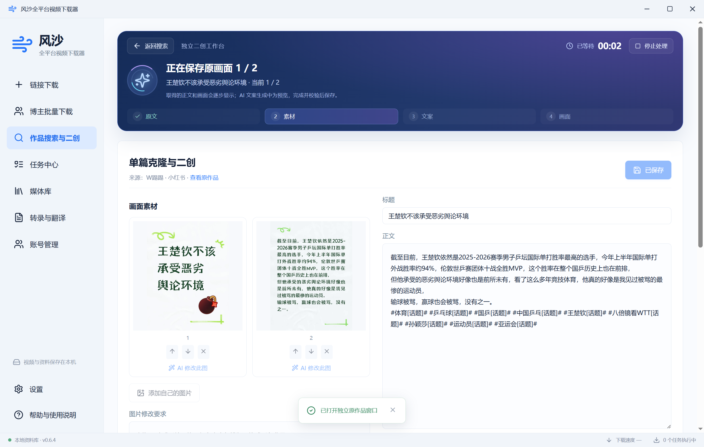

# 0.6.4 独立克隆工作台与流式二创验收

日期：2026-10-09。

## 体验变化

点击“一键克隆”立即进入独立工作台，搜索列表保留在返回页面。顶部动态光环、当前阶段、已等待时间、停止和返回入口清晰展示；文案与画面直接并排呈现，窄屏可以正常操作。等待计时为实际经过时间，不伪造完成倒计时。未执行的 AI 步骤不显示为完成。

原文、原图取得后逐步持久化；视频转录已有分段文稿及关键画面可逐步展示。AI 二创文案采用真实 SSE 增量预览，完整结束、JSON 与正文校验通过后保存。生成画面按张更新。停止、失败、截断和重启中断保留原稿及已完成素材。高频界面通知改为定期刷新，避免流式结果被积攒到最后；稿件版本检查防止迟到读取覆盖新图片。返回搜索保留未保存修改，克隆下一篇前先保存当前修改。

“原作品／查看原作品”打开独立、可见的官方窗口并显示反馈，沿用对应平台登录会话、保留必要访问令牌；HTTPS 导航检查与跳转升级保留。失败有明确原因；用户正常关闭窗口不会误报失败。其他模块的原链接行为保留。

## 验证

157 项单元回归通过。新增回归覆盖中文 UTF-8 拆包、CRLF、Chat／Responses 流、拒绝截断与错误响应、结构化文案预览、克隆过程中持久化与取消。独立 Electron 界面验证首图先于第二图出现、文案先于流结束显示、第一张生成图先于所有图片完成出现、等待计时、迟到响应不删除图片、返回后的未保存编辑、窄屏布局、明确可见的原作品窗口。完整二创／WebP 转换／FFmpeg 成片与关键帧回归通过；真实平台发布和私信未在测试中执行。

原小红书账号与系统网络实际验证：官方原作品窗口可见且读到真实标题；克隆取得 250 字完整正文、2 张原图，并进入独立工作台，原图正常显示。实际 CPA Chat 文本服务的一次短文验证收到 75 次增量回调，首个增量 2 字、最终 125 字，约 5.9 秒完成。没有用前端动画假装服务流式返回；本次未额外调用真实收费图片生成或语音训练。

流式协议依据：[OpenAI 流式响应说明](https://developers.openai.com/api/docs/guides/streaming-responses)、[Chat 增量事件](https://developers.openai.com/api/reference/resources/chat/subresources/completions/streaming-events)、[Responses 增量及完成事件](https://developers.openai.com/api/reference/resources/responses/streaming-events)。上游若只返回普通 JSON，会按其实际结果显示，不自动重复请求模型。

## 操作

1. 在搜索页按需选择“克隆后自动二创”，点击作品的“一键克隆”。
2. 工作台中直接看正文和画面，顶部观察阶段及等待时间；需要时停止处理。
3. 处理完成后编辑正文、排序或改图；二创要求和声音、发布操作位于编辑内容下方。
4. “返回搜索”保留当前稿件与编辑；可从“打开当前二创稿”或历史稿列表再次进入。
5. 点击“原作品／查看原作品”核对官方内容；需要登录或验证按官方页面操作。

## 正式覆盖安装验收

构建与覆盖安装退出码均为 0；安装包 CRC、7 项关键载荷、48 个包内 Electron 文件与最终源码一致，正式安装 ASAR 与交付包一致，内置语音环境导入通过。

正式安装版 0.6.4 使用原小红书账号复测：点击原作品打开可见窗口并取得真实标题；点击一键克隆立即进入独立页，250 字原文、2 张原图显示正常，等待计时存在，界面无脚本错误。原先的克隆稿也能正常打开。

安装前已备份并校验 5297 个资料文件；实际测试后原有 62 条非账号／元数据业务记录逐项哈希保持一致，4 个账号、6 条任务、6 个媒体、3 个转录记录、CPA 与声音设置保留。新增测试克隆稿保存在本机。
