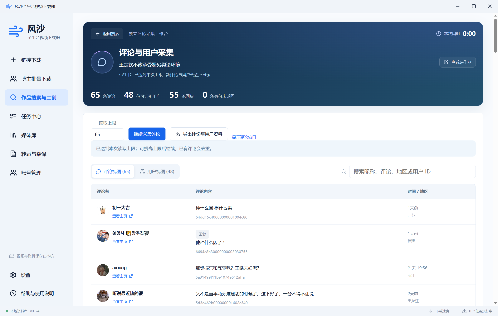

# 0.6.5 评论与用户采集验收

日期：2026-10-09。修复“一键采集评论只弹出官网，结果藏在搜索列表底部，并等待整次结束”的交互问题。

## 修改结果

点击后立即进入应用内独立评论工作台；官网普通读取保持隐藏，遇到实际登录／验证时才显示。评论与用户逐批刷新，顶部提供时间、数量与状态。评论视图保留逐条正文、头像、昵称、稳定身份、主评论／回复、时间和地区；用户视图合并同一身份的评论。支持筛选、停止、继续、返回后重新进入及导出。

初始任务和每批评论先持久化再通知界面。停止、异常、重启后保留进度；上限之外的批次缓冲保留，继续不丢评论。不根据正文中的“没有更多了”判断末页；仍有待展开回复时不声称全部完成。导出仅包含当前公开结果及用户集合，不包含账号身份和未显示的缓冲条目。

## 实际小红书验证

沿用本机已有登录账号，读取用户截图中的“王楚钦不该承受恶劣舆论环境”。没有修改系统代理／证书，没有发送真实私信或发布测试内容。

| 检查 | 实测 |
|---|---|
| 点击即进入独立页 | 123 ms；搜索列表隐藏 |
| 首批结果 | 4.522 秒取得 19 条评论、17 位用户，采集仍在运行 |
| 50 条上限 | 7.334 秒；36 位用户、40 条回复、50 条地区字段 |
| 提高上限继续 | 65 条，65 个唯一评论 ID，无重复 |
| 官网窗口 | 初始与继续均保持隐藏 |
| 昵称／评论筛选、用户合并、1080×720窗口 | 实际界面通过，无横向溢出或渲染异常 |

数据数量和速度仅代表本次平台返回结果，不保证所有网络、账号和作品都相同；50条／65条是读取上限，不等于该作品全部评论。

## 对抗式检查

| 场景 | 检查结果 |
|---|---|
| 旧版点击后不进入结果页 | 新增 Electron 点击路径测试先失败、修复后通过 |
| 首批取得但任务尚未结束 | 评论与用户已可查看；计时继续，停止按钮可用 |
| 同一用户多条评论、匿名评论、筛选 | 评论保留、用户合并，缺少稳定身份不猜测主页 |
| 首批之后失败 | 保留结果，继续按钮恢复可用 |
| 上限截断一批、重启继续 | 持久化缓冲，根评论／回复不丢失；视频号大整数保留 |
| 正文含“没有更多了”、待展开回复 | 不误报末页 |
| 搜索忙碌时开始或继续采集 | 拒绝后旧任务、上限、存档均不改变 |
| 有旧评论同时出现登录验证 | 暂停并显示官方窗口，不以已有评论绕过验证 |
| 实际小红书不同回复／地区字段 | 真实 DOM 复现后新增回归，修正并再次实测通过 |
| 返回搜索、重新打开结果页 | 搜索卡片和已取得评论保留 |
| 第二篇作品启动被拒绝 | 界面测试先红；修复后恢复上一份结果和来源，不以空任务替换原入口 |

171 项单元回归通过；独立页、流式显示、计时、筛选、匿名评论、失败保留和窄窗口 Electron 测试通过。独立只读审查发现的“第二篇启动失败后丢失旧结果入口”已用实际界面测试先红后绿验证，复核关闭。

## 正式桌面安装验证

正式安装包归档完整性和7项核心载荷核对通过；打包后的48个 Electron 源文件、当前 HTML／JS／CSS 与最终源码一致。原位置静默升级成功，安装版与最终 ASAR 一致，应用和 CLI 都为 0.6.5，语音组件实际导入正常。

在正式安装版沿用实际小红书登录：恢复65条历史采集结果，继续读取后停止保留67条，再次继续取得77条、59位用户、66条回复，77个评论ID均唯一。官网窗口保持隐藏；导出JSON与当前评论／用户数量一致，没有账号和内部分页缓冲字段。返回搜索再打开结果页、用户视图与评论视图均正常，未产生渲染异常。

升级前对4601个用户数据文件做逐文件校验备份；安装及真实采集之后，原有68条业务记录哈希保持一致。原4个账号、6个下载任务、6个媒体项、3个转录项保留。测试未向真实用户发私信或发布作品。

## 对标核对与边界

本次实际抽帧检查用户提供的49.58秒对标视频：00:23 为采集入口，00:36 展示昵称、IP属地、评论正文、ROOT／REPLY及计数。指定桌面直播原MP4当前不存在；已复核此前保留的直播截图，不声称本次重新完整播放该源视频。

小红书真实采集已验证；视频号根／回复分页、B站回复层级及其他平台页面适配为隔离回归。没有宣称五个平台真实评论采集、私信发送或全量采集都已通过。平台隐藏、删除、未加载和无权访问的资料不在结果范围。
