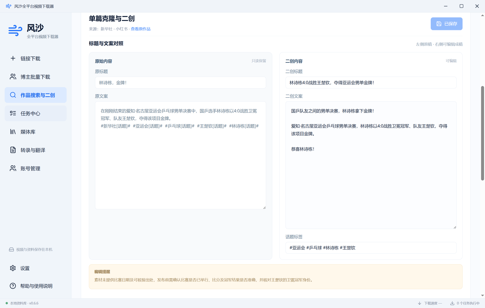
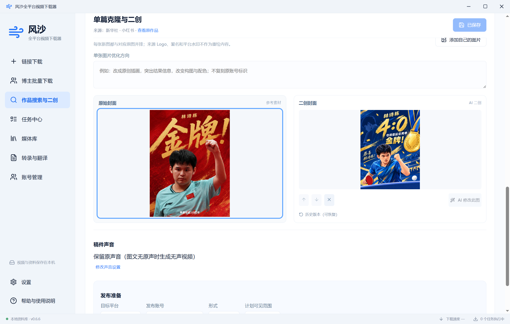
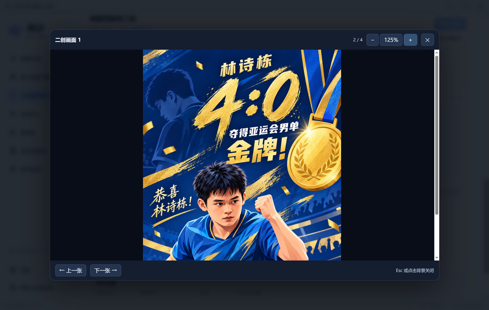

# 0.6.6 原稿对比与二创验收

日期：2026-10-09。

## 本次修改

独立工作台顶部集中填写二创方向；未勾选自动二创时只取得原文和原素材，空白方向不能启动整篇生成。原标题／原文案与可编辑的新标题／正文／话题并排；原图与对应新图逐张配对，尚未生成的新图显示待处理。排序移动整对，删除新图保留原图；历史图片点击放大，旁边的恢复按钮执行恢复，不混用同一点击动作。图片服务配置入口移至统一设置。

项目内 [小红书二创 Skill](../skills/xiaohongshu-remix/SKILL.md) 与实际生成提示保持一致：先提炼事实和阅读动机，再重组角度、标题、首段、短段正文和相关话题。不得虚构新闻来源、亲身经历或补充成绩；需要编辑核对的事项保存在独立提醒区，不混入发布正文。没有承诺必然产生爆款。

画面要求采用新的插画／信息图构图，禁止复制来源账号、媒体、平台水印、签名、二维码及服装／器材品牌标识。该约束是生成提示，不是自动版权鉴定或 Logo 检测。发布前仍应核对内容事实、肖像与素材使用权；不能通过去除标识宣称原图属于自己。

全局图片预览支持点击、键盘打开、缩放、分组切换、ESC关闭、错误重试和焦点恢复。视频保留原生播放控制，另提供放大入口；实际已有本地视频直接播放。没有取得视频源的搜索封面只放大封面，并明确说明不能播放。

## 真实模型与素材检查

沿用本机已取得的“林诗栋，金牌！”原文及原图，通过用户现有 CPA 服务实际生成文案和图片。没有修改系统代理／证书，没有发送真实私信或发布测试内容。

- 首次文案真实流式首段约43.5秒；标题、正文、话题生成并保存，编辑核对提醒单独保留，没有“据参考消息”等虚构归因。输入新闻事实未做外部赛事核实，不宣称此案例事实已验证。
- 第一次实际图片未通过视觉验收：仍接近原摄影／红色构图，存在品牌标识。保留该历史版本，修正方向过滤及画面约束。
- 第二次实际图片约45.7秒生成，遵守蓝金方向，形成新插画构图；人工查看未见“新华社／小红书”署名和服装品牌 Logo。共执行2次真实出图，原图与两个历史版本都保留。
- 实际保存稿的原文／新文案、原图／新图并排，放大后缩放125%、切换与ESC关闭通过；已有本地视频放大后实际播放通过。

时长仅为本次模型与网络实测，不设置伪造的剩余时间。界面显示已等待时间及实际阶段，正文逐段预览、图片逐张出现。

## 对抗式检查

204项单元测试通过；并排工作台17项场景、媒体预览11项场景及专门的3项异步竞态界面检查通过。相邻评论流式、二创流式与完整内容流程继续回归。

| 反例 | 验证结果 |
|---|---|
| 延迟读取覆盖用户刚编辑的正文 | 实际 Electron 先复现失败；修复后编辑保留 |
| 处理中收到另一旧稿快照 | 当前作品与内容不被替换 |
| 正文有“日期待核实”及年龄／费用限制 | 完整事实和限制保留，不按关键词删掉 |
| 模型输出参考稿评论或核查报告 | 无效正文不替换原稿；提醒单独保存 |
| 蓝金、三张竖卡方向同时写“不保留Logo” | 合法风格与数量保留，禁止标识约束仍有效 |
| 部分图片失败或尚未配置 | 明确显示部分完成，不能显示全部成功 |
| 保存后重启失去任务内存 | 根据已保存素材和生成记录恢复阶段证据 |
| 二次改图、排序、删除、恢复 | 始终配对真正原图，历史版本不丢 |
| 图片点击误触恢复或勾选 | 放大与恢复／勾选动作独立 |
| 缺少视频封面、视频文件不存在 | 有文件仍可放大播放；无文件显示错误 |
| 1080宽窗口、焦点陷阱、ESC、原生视频控制 | 无横向溢出，播放／音量控制保持可用 |

独立只读审查提出的6个具体问题已补回归并修复复核。隔离测试使用本机平台页面和模型协议夹具；模拟发布／私信仅在这些夹具中执行，不代表五个平台真实发布或私信已验收。

## 交付检查

升级前4741个用户数据文件、679208712字节已复制并逐文件校验备份。最终 NSIS 安装包归档完整性及7项关键载荷一致性通过；49个 Electron 源文件、当前 HTML／JS／CSS、小红书 Skill 与打包 ASAR 一致。原位置静默升级退出码0，正式可执行文件／ASAR／采集组件／CLI版本与最终包一致；语音组件实际导入正常。

正式安装版0.6.6沿用实际保存稿：原标题／原文只读，新正文可编辑；真实原图与第二张蓝金插画准确配对，点击放大、125%缩放、切换和ESC退出通过。手动方向空白不启动，返回搜索保留未保存编辑，重启保留已生成阶段，1080宽窗口无横向溢出。原77条评论结果可恢复，已有本地视频实际放大播放，未出现渲染错误。

安装和上述检查后，原有71条非账号／元数据业务记录哈希一致；4个账号、6个下载任务、6个媒体项、3个转录项保留。账号／元数据的正常使用时间更新不作为业务内容修改。没有新增真实发布、私信或模型调用。

GitHub源代码、安装包、说明ZIP和SHA256校验文件采用版本0.6.6发布；源文件及资产哈希以发布后的服务器回读校验为交付依据。
