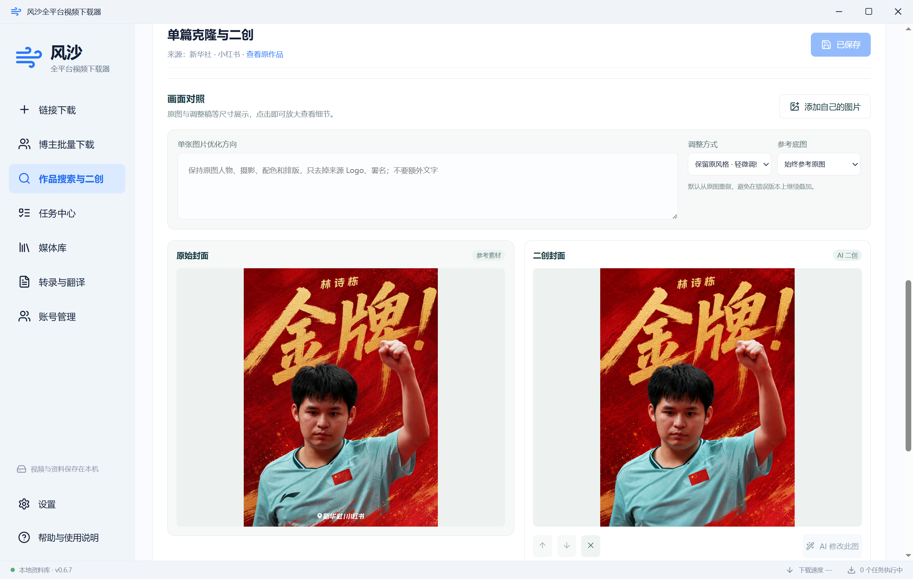
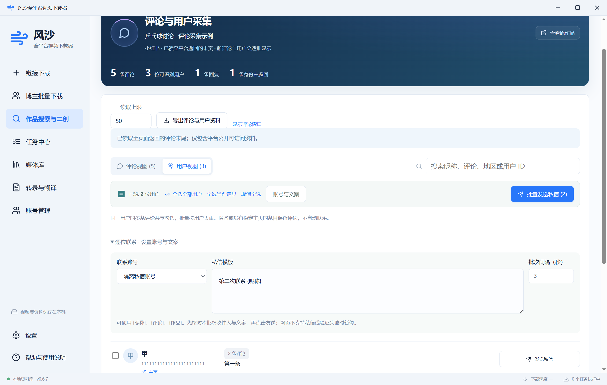

# 0.6.7 评论读取、选择私信与图片轻调验收

日期：2026-10-09。

## 问题与修复

- **评论中断**：原末页判断遍历所有元素，SVG没有`innerText`，直接`.trim()`会抛异常并被Electron包装为“Script failed to execute”。新增真实SVG节点反例先失败，修复为安全文本读取后通过；独立`comment-item-sub`回复也纳入读取。脚本错误保留具体类型和中文处理提示，已有评论、缓冲与续读位置保留，不把失败当末页。
- **选择私信**：评论／用户旁都有单独发送入口；支持全选全部用户、全选当前结果、取消全选及单独勾选。同一用户多条评论共用选择，匿名或缺少稳定主页的条目不可自动联系。批次先展示准确收件人及逐位文案，再按间隔逐位处理；停止保留未发送项，失败暂停，已尝试的同账号／用户／文案不自动重发。
- **画面失真**：移除强制插画／全新构图提示，默认保留原摄影／插画、主体、姿态、颜色、版式和原文字数量，只按方向局部调整、清理来源及品牌标识。长正文不自动进入图片提示。再次编辑默认传真正原图，可明确选择当前图片；请求尺寸跟随参考图横竖方向。
- **布局**：应用frontend-design方法，将方向与编辑方式集中成操作栏；原图和新图等高、同基线，图片历史折叠为小缩略图，移除、排序和恢复分开。图片拖入方向框被阻止，粘贴的内部媒体路径会清理。文案保留并排对比。

## 实际验证

使用本机已有小红书会话的隔离副本，在同一篇“林诗栋，金牌！”续读：40条增加到55条，达到本次上限；未出现原脚本错误，没有冒称全部92条都已取得。

真实CPA模型共调用2次图片编辑。首次恢复摄影、人物姿态及红金版式，去除底部来源标识，但衣服品牌仍在；放大复核后补充局部清理约束。第二次保留摄影、主标题和版式，人工观察未见底部来源／平台署名、服装品牌和新增小字。两次约107秒、112秒，仅代表本次模型响应，不作为固定等待时间承诺。原正文保持不变；接受的图片进入当前稿件，原图及历史图保留。

生成仍可能微调像素或人物细节；标识清理不等于自动取得素材使用权，也不是自动版权鉴定。实际发布前需核对生成图和素材权限。

## 对抗式检查

221项单元回归通过；原稿对比18项、媒体预览11项、异步编辑竞态3项，以及单独／所选批次／停止继续／接收者校验等Electron界面检查通过。

| 反例 | 结果 |
|---|---|
| SVG无innerText、独立小红书回复类名 | 先失败后修复；真实DOM夹具与真实会话续读通过 |
| 预览批次夹入未选择用户／重复ID／错误账号 | 在打开页面或发送前拒绝，旧批次保留 |
| 同一用户多条评论、匿名条目、全选／取消选择 | 用户选择同步，匿名保留内容但不可联系 |
| 单独联系一人、批次只选两人 | 隔离官网按钮点击记录准确，未夹入第三人 |
| 接收者外层是甲、内层聊天对象是乙 | 拒绝填写和发送，不点击错误对象 |
| 公开评论框也显示“说点什么” | 真实DOM夹具先失败；修复后不填入、不误发公开评论 |
| 输入后聊天对象或正文异步变更、同窗存在消息搜索框 | 点击前再次核对身份和实际文本，搜索框不当作发送框 |
| 没有入口、响应在点击后丢失 | 暂停；先保存uncertain，不能自动重复 |
| 批次间隔中停止、重启时处于准备中 | 保留未发送用户，已尝试项不重发 |
| 完成结果滞留busy、单独准备误报旧批次执行中 | 修复并通过回归 |
| 开始采集后立即切用户视图 | 最终结果返回不再把视图重置为评论视图 |
| 多次改图、原图／当前图切换、重设计方式 | 实际请求底图字节及选项核对通过，历史关联不丢 |
| 输入框混入内部媒体地址 | 自动清理路径，不清掉后面的中文要求 |
| 1080窗口、图片放大、播放与原生控制 | 无横向溢出，预览相邻回归通过 |

私信提交只在隔离官方页面夹具执行，记录了实际按钮点击；没有向真实用户发送私信或发布作品。各平台网页入口和账号权限不同，不能把本次模拟提交当成五平台真实送达验收。

## 交付验证

升级前2699个用户数据文件、410547247字节已复制并逐文件校验。最终安装包归档完整性和7项核心载荷一致性通过；50个Electron源文件、当前HTML／JS／CSS与小红书Skill同最终ASAR一致。构建中遇到Windows临时占用后在新目录重建，未将失败包发布。

2026-10-10原位置静默升级退出码0。正式安装版应用、CLI和载荷均为0.6.7，语音组件实际导入正常。沿用实际小红书会话，在正式安装版将40条评论继续读到55条、55个唯一ID，旧40条ID全部保留，没有原脚本异常；状态为本次上限，并不声称已读完全部评论。

正式桌面验证：原图与接受的摄影调整图等高并排、放大125%、路径粘贴清理、未保存编辑跨页保留、逐位私信面板、全选／取消／单独选择、1080窗口及实际本地视频播放均通过；未调用模型、未向真实用户发消息。批次提交和错误聊天上下文仅在隔离页面验收，不在真实收件人身上测试。

72条其他业务记录哈希一致，25个原稿素材文件未改；本次允许变化的两份记录分别为新增图片版本的当前稿和新增评论的所选采集记录，原标题、原正文、原素材和旧评论ID保留。4个账号、6个下载任务、6个媒体项、3个转录项保留。GitHub交付包含版本源码、完整安装包、图文说明ZIP和SHA256文件，资产以服务器回读为准。
