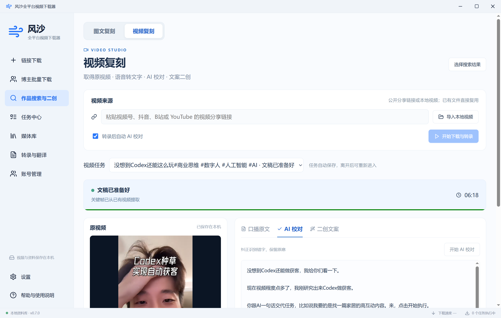

# 0.7.0：图文复刻与视频复刻独立处理

## 原因与行为

旧工作台把作品说明、封面和完整视频口播放在同一流程。旧视频号记录只有内部作品地址时，提取口播和关键帧又回到电脑微信连接，导致已有内容仍反复弹窗等待。

已实际检查风沙 AI 学习平台的公开分享解析、视频下载和转录代码。新版沿用下载器已有的独立分享解析、解密校验与本地转录能力；不修改学习平台，不读取其登录凭据。

- 顶部独立“图文复刻 / 视频复刻”入口；图文保留正文和图片对照、轻微润色、单独改图。
- 视频输入公开分享链接或导入本地视频，按取得原视频 → 语音转文字 → 可选 AI 校对处理。使用下载器自身已保存的官方链接解析账号；此路径不要求打开电脑微信。
- 口播原文、AI 校对、二创文案独立页签。作品说明单独展示，不冒充口播；校对保留识别原文，二创不重新下载或转录。
- 已下载视频与关联转录文件直接复用，关键帧按需从已有视频提取。原视频可播放和放大；关键帧可点击放大。
- 视频任务自动保存，可从“视频任务”选择器重新进入。同一来源重复开始打开已有任务；停止保留视频和已取得文稿，继续处理复用文件。手工文案保存前不能切换任务丢失修改。
- 旧记录如果只有内部地址和封面、没有媒体缓存，立即说明缺少视频，允许粘贴公开分享链接或导入本地视频，不再打开微信等待，也不把封面当成完整视频。

## 已验证

- 全部单元测试 **288/288**。
- 独立视频工作台端到端验证通过：实际加密素材下载、解密和校验；停止后继续；AI 校对及单独二创；关键帧复用；任务重新进入和重启。平台及模型边界采用隔离数据，不能代替真实平台证明。
- 图文工作台回归 **21 项**：原稿/当前稿对照、流式生成、独立文案与图片、历史恢复、停止、窄窗口、手工编辑保护和重启保存。
- 一条真实公开视频号分享链接通过下载器自身已登录账号直接下载、解密与完整校验；实际本地 Whisper 转录 **204 字**；实际配置文本模型校对 **219 字**，识别原文保留。全程禁止调用电脑微信页面采集接口。
- 同一真实视频已实际播放，播放时间前进；从已有视频提取 **4 张**关键帧，未再次解析或下载。1080 像素宽窗口无横向溢出。

0.7.0 已覆盖安装，正式程序 52 个后端文件与验证源码一致。升级前备份并逐文件核验 **4,647** 个用户文件；安装后首次启动前全部一致。重启后 **131** 条业务记录、**3,929** 个保留文件及 **4** 份登录会话内容一致；浏览器日志、缓存和重新加密的会话封装随启动更新，不误报为业务资料丢失。4 个账号、6 个下载任务、6 个媒体、9 份转录均保留。

正式安装程序使用隔离资料目录打开上述实际视频任务，视频播放、204 字原文和 219 字校对稿展示、关闭重开与任务重新进入通过；没有重复下载或调用模型。安装包 SHA-256：`77265886488A5570056170C355623723486038B4D3552A8E1E76056CE143C26E`。测试输出与实际媒体均留在本机忽略目录，不上传用户资料。

## 使用与限制

进入“作品搜索与二创 → 视频复刻”，粘贴公开分享链接，或导入本地 MP4/MKV/MOV/WebM。视频号链接需要在“账号管理”保存下载器使用的官方链接解析登录；若会话过期，按明确错误重新完成官方登录。无须反复打开、刷新电脑微信，也无须关闭 Clash。

从作品搜索结果点击“视频复刻”时，优先复用已取得的媒体缓存或本地视频。旧内部地址本身不等于公开分享链接，不能凭地址还原已丢失的媒体信息。视频需取得本机素材才能本地识别，现保留一份原视频供播放与复用；不承诺完全不占空间。

关键词搜索、博主列表、评论采集仍是独立的微信页面采集流程；本次真实验证证明公开视频号链接下载与转录可用，不代表所有平台搜索、所有链接和账号状态均可用。AI 校对与二创的质量仍需用户核对。
